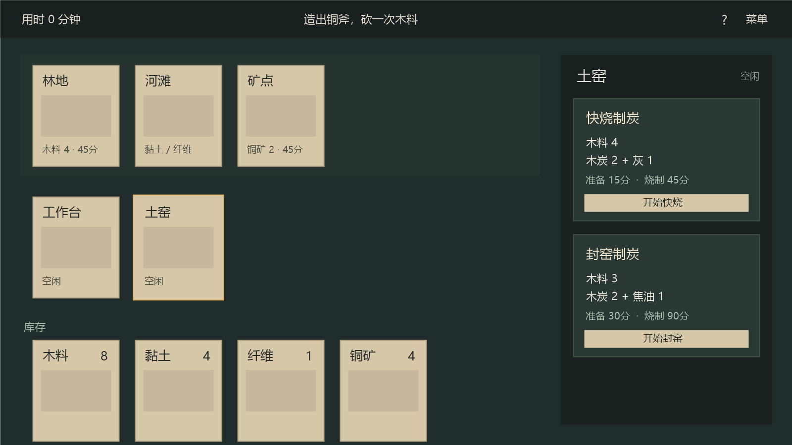

# 工艺卡牌：首版策划

2026-11-04。用户已要求按本文作为独立“测试玩法”实现，保留原自由牌桌。源码、配置与场景位于 Assets/TestGameplay，入口从原桌面的“测试玩法”按钮进入。配方、时长和收益仍是待实际操作验证的设计值，没有试玩结论。本稿替代上一稿的锅火、水罐漏水和定时饮食原型。

## 做什么

做一款单人工艺经营卡牌游戏。玩家在一张桌面上安排原料、工位和工具：选一种加工方法，付出材料和人物时间，让设施继续加工，再把主产物和副产物用于下一道工序。

第一段围绕木炭、陶器、铜工具展开。玩家会遇到三个具体问题：要尽快拿到炭，还是省木料？灰用来改炉，值不值得占掉这半小时？先花更久封窑拿焦油，能不能省掉后面的熔铜时间？

你之前提出的“同一级别主产出相同、副产出不同”放在这里实现：两种炭工艺都出木炭 2，一种留下灰，一种留下焦油。原料投入、人物工时和占炉时间也不同，避免只换一个副产物名字。

首版采用行动推进时间。看牌、拖牌、读配方都免费，点“开始”才扣材料并推进人物耗时。没有现实时间倒计时。

## 为什么选这个方向

| 方向 | 能玩到的东西 | 对两人开发的影响 | 本案取舍 |
|---|---|---|---|
| 工艺小工坊 | 选加工方法、安排共用工位、副产物再利用、工具改善生产 | 静态物件图就能表达，规则范围可控制 | 首版采用 |
| 完整卡牌生存 | 生存状态、环境、容器、伤病与加工相互影响 | 状态、例外和内容量明显增加 | 工艺成立后再判断是否需要 |
| 实时卡牌村庄 | 多工人派工、供给、人口、战斗或探索 | 增加单位管理、节奏、敌人和更多美术 | 退出首版 |

《卡牌生存》给出了同目标的不同工艺、工具减少重复劳动的实例；《堆叠大陆》和《WitchHand》的更新说明重复投料、收料和找牌需要减负；《密教模拟器》的开发记录提醒我们，组合系统必须让玩家理解自己在改变什么。《缺氧》提供的是产物、设施与后续生产互相影响的思路。逐项事实、日期和出处见[参考记录](参考记录.md)。

确定性的小工坊最终可能被解出固定流程；首轮要检验玩家是否愿意比较工艺，以及换一种短缺时是否改变安排。

## 第一段完整流程

目标是做出一把铜斧，再用它采集一次木料。完成后展示用时和制作消耗，可继续留在工坊。希望首次体验约 20～40 分钟，这是内容长度目标，不是实测结果。

开局人物空闲，工作台和土窑都空闲。库存为木料 8、黏土 4、纤维 1、铜矿 4，其余为 0。没有预先替玩家开始的加工，也没有免费发牌列表。

玩家亲手选择第一批炭工艺，烧制时去捏陶坯或采集。木炭烧成后，既能烧坩埚，也能熔铜；灰能改炉，焦油能助燃。坩埚不消耗，做出它就获得了熔铜能力。最后把铜锭装成铜斧，下一次取木由 45 分钟缩短为 30 分钟，产量仍是 4。

~~~mermaid
flowchart LR
    木料 --> 快烧
    木料 --> 封窑
    快烧 --> 木炭
    快烧 --> 灰
    封窑 --> 木炭
    封窑 --> 焦油
    黏土 --> 陶坯 --> 坩埚
    灰 --> 炉衬
    木炭 --> 熔铜
    铜矿 --> 熔铜
    坩埚 --> 熔铜
    焦油 --> 助燃熔铜
    炉衬 --> 普通熔铜省炭
    熔铜 --> 铜锭 --> 铜斧
    助燃熔铜 --> 铜锭
    铜斧 --> 取木更快
~~~

图只说明用途关系，具体扣料以配方表为准。

## 首版的全部操作

人物只有一个，同一时刻只能做一项主动操作。土窑只有一座，同一时刻只能占用一批；工作台准备陶坯、装配铜斧时，土窑可以继续烧制。

### 采集

| 地点与操作 | 人物耗时 | 得到 |
|---|---:|---|
| 林地：捡木料 | 45 分钟；有铜斧后 30 分钟 | 木料 4 |
| 河滩：挖黏土 | 30 分钟 | 黏土 2 |
| 河滩：取纤维 | 30 分钟 | 纤维 2 |
| 矿点：采铜矿 | 45 分钟 | 铜矿 2 |

地点首版不枯竭、没有移动地图和随机掉落。代价是人物时间。无限原料意味着本版没有资源绝境，工艺比较先看用时、用木量和结束后的设施状态。

### 制作

“人物准备”会推进其他已开始的加工；“后台”从准备完成时才开始计时。配方投入包含燃料，不再额外扣一份点火费用。

| 工艺 | 投入 | 人物准备 | 后台 | 结果与条件 |
|---|---|---:|---:|---|
| 快烧制炭 | 木料 4 | 15 分钟 | 45 分钟 | 木炭 2、灰 1；占土窑 |
| 封窑制炭 | 木料 3 | 30 分钟 | 90 分钟 | 木炭 2、焦油 1；占土窑 |
| 捏陶坯 | 黏土 2 | 15 分钟 | 无 | 陶坯 1；用工作台 |
| 烧坩埚 | 陶坯 1、木炭 1 | 15 分钟 | 60 分钟 | 坩埚 1；占土窑 |
| 装炉衬 | 灰 1、黏土 2 | 30 分钟 | 无 | 土窑获得炉衬；要求窑空闲，施工期间占窑 |
| 普通熔铜 | 铜矿 2、木炭 2；有炉衬时木炭 1 | 15 分钟 | 60 分钟 | 铜锭 1；占土窑，需要坩埚但不消耗 |
| 焦油助燃熔铜 | 铜矿 2、木炭 1、焦油 1 | 15 分钟 | 30 分钟 | 铜锭 1；占土窑，需要坩埚但不消耗 |
| 装配铜斧 | 铜锭 2、木料 1、纤维 1 | 30 分钟 | 无 | 铜斧 1；用工作台 |

装炉衬只做一次，再次执行直接拒绝且不扣料。炉衬不减少助燃熔铜的木炭消耗；助燃即使在有炉衬时仍能缩短占窑时间。工具首版不损坏、不叠加加成，不另做修理税。坩埚和铜斧各保留一个，不开放重复制作。

八条工艺另有[配方草表](首版配方草表.csv)，作为策划对照。实际运行读取 Assets/TestGameplay/Configuration/测试工坊配置.asset；开局与目标读取其引用的三个开局资产。CSV不自动导入，额外规则栏不是待执行脚本。

灰是本段一次改善的投入，焦油是可以反复使用的加工耗材。暂时没有其他用途的多余灰允许留存，不为了清库存补订单。首段过短可能让永久炉衬不值得做，这是一项要观察的风险。

同主产物不要求成本相同。本段的两种制炭从开局都可用，供玩家直接比较；以后增加工艺时仍须给旧法保留使用场景。

## 玩配方具体指什么

选土窑能同时看到两种炭工艺，列出投入、人物准备、后台时长、主产物和副产物。拖木料到土窑上，只筛出相关工艺；它不扣料，也不自动猜选哪一种。

已知工艺可以直接点选，由库存自动带入一批所需材料。两种入口最终执行同一条命令。重复拖四张木料不作为熟练度要求。

第一次获得木炭后，开放烧坩埚；获得灰或焦油后，分别开放装炉衬与助燃熔铜；获得坩埚后开放普通熔铜；获得铜锭后开放铜斧。捏陶坯和两种炭工艺开局已知。解锁只依据“曾获得”，材料用光不会忘记工艺。

锁住的后续工艺允许查名字、投入与解锁条件，执行按钮写具体缺口，例如“需要坩埚”“还缺木炭 1”。选材料可查用途，选成品可查来源。默认只展开当前对象有关的几条，不把整棵树铺在桌面。

首版没有全组合盲试、失败随机吞料、研究点货币或跨局科技。这里的发现来自新材料打开新操作，以及玩家理解已有材料还能换一种用法。

## 时间、占用和收料

1. 执行前校验工艺、材料、工具、解锁与工位。失败则库存、时钟和工位都不变。
2. 成功时一次扣除这一批投入，并立即占住所需工位。准备时间也算占用，不能让同一窑在准备和烧制中同时接两批。
3. 人物准备期间，其他已经开始的后台过程继续。准备完成后才建立新烧制批次的完成时点；纯人物制作在准备结束时给结果。
4. 到达后台完成时点，一次发放整批主产物、副产物，并释放工位。产物自动进逻辑库存，不要求再点收取。
5. 人物去做长操作，过程中烧制可能先结束。烧制照常完成，人物仍做完已经支付时间的操作；不自动替玩家开下一批。

用整数分钟。查看期间不推进，确认一项操作后计算至动作结束，画面用短动画表现变化；动画时长不等于游戏分钟。等待按钮是“等到烧好”，推进到最近一项后台完成；没有后台过程时不推进时间。

开始烧制后首版不取消、不换工艺、不部分退款。误拖不会开工，执行前能看清全部代价。没有混烧、半份燃料、供火温度、焦糊、实时熄火或领取容量。这些都属于新增规则，不能悄悄补进第一版。

没有 20:00 强制失败、睡觉、漏水和定时饮食。完成目标即结束首段，超时不删档。结尾分别展示“总用时”和“制作投入木料”，不加难解释的综合评分；总木耗累计所有配方扣掉的木料，采集回来的木料不能抵销它。

取消生存和截止意味着：如果玩家不在意用时，慢的代价就弱。现在只能验证短流程的成本判断，不能宣称已有长期经营压力。是否需要有限工期，要等这一段实际反馈后再决定。

## 卡牌和桌面分别承担什么

库存按物品 ID 统计数量，同种物品一张牌显示数量。桌面位置只影响摆放，不能改变库存是否存在、生产是否完成。超过屏幕可见范围就滚动，不因没有二维空位阻塞收料。

物品牌表示拥有的材料和工具，工位牌表示当前批次和占用。材料拖到工位表示“想用它做什么”；拖完仍由玩家选具体工艺。设施不能和普通原料按“同分类”自动混成一堆。

首版不要求拆出单份牌，不做工具借给多个设施的争用。坩埚是全局已拥有工具，只有一座土窑，不额外引入借用锁。如果后续增加第二工位，再单独设计工具归属。

独立测试玩法不包含翻面、洗牌、堆内前后移、抽顶牌、按序号排牌和任意发牌。原自由牌桌保留这些既有功能。库存归类和查看用途属于测试玩法；将来若有未知地点或卡包，再评估揭晓规则。

## 界面和必要动画

图只示意信息位置，没有绘制物件插画，也不是 Unity 运行截图。测试实现已另接统一手绘物件与卡框，原牌桌美术保留。

桌面上方放林地、河滩、矿点三张地点卡，中间是工作台和土窑，下方是库存。只在选择物件时打开右侧详情。没有选中对象时收起详情，把空间留给卡牌。

土窑工作时显示“封窑制炭 · 还需 45 分钟”和进度；装好炉衬后在该牌上显示短状态。库存只放名称、插画、数量。顶部只留用时、当前目标和菜单，人物没有饥渴条。

选择土窑后，两种制炭工艺的代价放在同一个详情内，可以横向比较。按钮示例为“快烧 · 准备15分”，旁边单列“烧制45分”；不能让玩家误以为点完15分就拿到炭。

必要反馈包括拿起、落下、无效落点归位、开工投入归入工位、进度变化、成品短暂出现后归库存。落点高亮同时有轮廓，不能只靠红绿。动画使用短过渡，可以跳过，不阻塞连续查看。普通成功不反复弹文字。

开局帮助只在第一次需要时出现一句“把木料放到土窑上”，随后引导一次选择工艺；完成后收起，问号里可重看。新材料在相关卡片或工艺列表留一个可消除的提示，避免连续弹窗。

## 美术预算

测试实现使用 SpriteCook 同批生成的 11 个物件图标：木料、黏土、纤维、铜矿、木炭、灰、焦油、陶坯、坩埚、铜锭、铜斧；另有工作台、土窑和三个地点，共 16 个静态对象图。空卡框参照该批物件生成，统一纸张、土色调与手绘轮廓。资源位于 Assets/TestGameplay/Art，原牌桌的卡框、主题与背景没有改动。

炉衬是土窑状态，先用角标表现，不另画完整设施。没有人物立绘、行走、战斗、昼夜背景或每种工艺独立动画。物件图可由 AI 生成，但统一视角、光源、轮廓和边距；未生成前用名称加简形占位即可。

测试资源从 WorkshopConfiguration 的独立外观字段读取，物件和工位逐项绑定图集 Sprite。音频尚未接入；若后续增加，先只考虑拿放、开工、完成三类。现有包里的英文展示海报不进入玩家画面。

## 实现要改到哪里

原项目的自由牌桌继续保留。测试玩法使用独立 Core/Unity/Editor 程序集、配置、Prefab、场景和存档；沿用纯 C# 状态、真实 Prefab、拖放预览和提交后动画的做法，不共用库存或原存档。

实现由纯 C# WorkshopEngine 唯一拥有 WorkshopSnapshot，保存库存、分钟、工位批次、曾获得材料、炉衬和目标状态。已知工艺从材料历史与开局规则推导。桌面只显示对象，不另存一份库存，也不和原 BoardEngine 同步数量。

| 内容 | 建议落点 | 边界 |
|---|---|---|
| 物品名称、图标、稳定 ID | WorkshopConfiguration 的物品与场景对象列表 | 不用排序序号、万能属性代替配方含义 |
| 投入、主副产物、准备、后台、工位、工具、解锁 | WorkshopRecipeSetting 转为纯C#目录 | 中文 Inspector 可改；只展示已实现字段 |
| 开局库存、已知工艺、目标 | WorkshopScenario 独立资产 | 灰盒与完整流程是不同配置 |
| 校验、扣料、推进、产出、解锁 | WorkshopEngine 的统一事务 | 候选状态统一校验后一次提交 |
| 当前批次、工位升级 | 明确的工位与批次数据 | 不把“在烧制”写进任意字符串属性 |
| 卡片、选中详情、进度 | 复用视图组件并改 Prefab | 显示提交后的状态，动画不增减材料 |
| 保存 | 复用原子写入与备份外壳 | 新文件名与新载荷版本，旧自由牌桌档不强行迁移 |

当前命令为采集、开始工艺、等待最近完成、重新开始、保存与读取。库存采用自动网格，不另做自由排版。选中、拖动筛选和读配方属于界面行为，不写游戏库存。

土窑数量很少，用整数完成时点，逐个取最近事件推进即可。每次扫描几个工位比先做 ECS、多线程或通用调度框架更容易维护。工艺列表也只需按工位和原料查几条；不开发自动求最优生产顺序的算法。

用户最新要求采用独立入口，因此不再替换或删除原自由牌桌实现。新模块只实现本案所需操作，不从旧牌桌引入无关按钮和快捷键。进入时停用原场景根对象，返回时卸载测试场景再恢复，原牌桌状态保持在内存中。

## 开发顺序与工作量

按两人稳定投入、至少一人熟悉 Unity、继续使用占位图估计。下列为人日，包含必要调整，不是日历承诺；兼任工作和熟悉项目的时间需要另算。

| 阶段 | 交付内容 | 人日估计 | 用户能看到的结果 |
|---|---|---:|---|
| 灰盒闭环 | 数量库存、统一时间、5条核心工艺、4种采集、单窑状态和比较界面 | 8～15 | 开局送坩埚；两法制炭，灰改炉，焦油助燃，炼出铜 |
| 完整首段 | 补陶坯/坩埚/铜斧、解锁与目标 | 6～10 | 从木料做到铜斧，取木时间确实变化 |
| 可交给外部人体验 | 存档接入、简短引导、反馈、占位替换、规则与界面修整 | 11～20 | 一段可从头完成、退出后接着玩的演示 |

累计约 25～45 人日。两人并行仍有状态接口和 Prefab 接线的依赖，不能机械除二当交付日期。现阶段难点主要是取舍是否成立、信息是否清楚，算法本身难度较低；整段难度中等。

第一项开发先把“一次制炭→人物做别的→主副产物到账”做成真正游戏操作，再扩配置页。每个阶段都交付能操作的场景。

## 怎么判断值不值得继续

先用开局送坩埚的灰盒，不要求玩家先走完整解锁链。让玩家炼出三块铜，记录其第二批选哪种炭工艺、是否用灰或焦油、选择前看了什么。

采用同样配方的不同开局，改变现有木料、人物是否还需采集和手头副产物。两条工艺始终可选，不通过封锁按钮强迫走某一路。具体库存和可执行路径见[纸面流程](纸面流程.md)。交换开局的体验顺序，避免第二次更熟悉被误当成设计有效。

值得保留的信号是玩家能说明“这次我缺的是时间/木料/炭，因此换一种做法”，而且操作结果符合其预期。反例是玩家熟悉后永远同选一法，灰油只是多余图标，或者大部分时间用来找卡、等窑。

发现反例时先改这几条工艺、投入和工位关系。不要用随机订单、更多材料和生存状态掩盖。若两种路线仍无意义，收回一条；若单窑让所有安排过于固定，下一项可单独试“第二工位与共用工具占用”，不能与本轮规则一起开做。

完成一段后，铜斧与炉衬应确实让原来的麻烦减少。不要靠反复损坏把同一麻烦再造回来。这个规模还不能证明长线重玩价值；后续是否加陶器批量生产、第二工位或更高工艺，要根据这一段的反馈决定。

## 首版边界

本案止于一名人物、工作台与一座土窑、三个地点、11种库存物品、8条制作工艺、4种采集动作、一个铜斧目标。不是完整商业版的内容承诺。

不做战斗、联网、移动端、人口、复杂剧情、随机品质、自由液体容器、逐格温度/气体/液体模拟、全组合化学、天气、种植或大科技树。不先做通用节点编辑器、脚本语言和大型自动化系统。

所有边界都是本轮推荐的开发收缩。后续决定改动时先改规则稿与配置，再改实现，避免相互矛盾的方案同时留在运行入口。
