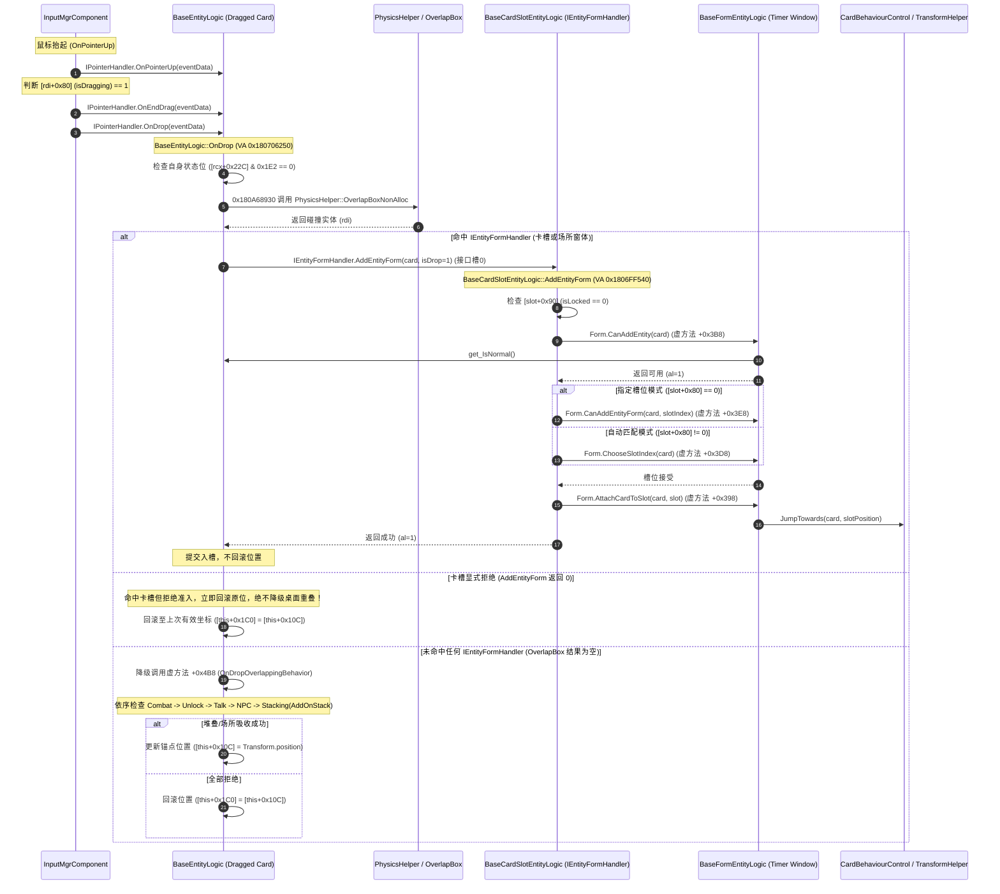

# 证据链01：卡槽命中与存取逆过程

> 独立复核未通过完整闭环：拒绝分支图文矛盾及指令地址错误。具体依据见[执行复核](../10-执行结果独立复核.md)，原正文保留待修正。

> 交付阶段：第1条完整证据链还原（依据 `07-拆解质量复核与缺口.md` 第4节要求）。  
> 状态：**已完成反汇编追踪与资产对应验证**。  
> 遵守规则：严格区分原作原生指令事实（E1/E2）与本项目落地契约（D），凡未逆向完全分支标注为“未知”。不启动Unity、编译器或测试命令。

---

## 1. 证据概览与定位表

| 环节 | 原生符号 / 资产 | Token | VA / PathID | 证据级别 | 核心指令 / 字段证据 |
|---|---|---|---|---|---|
| **松手调度** | `InputMgrComponent::OnPointerUp` | `0x6003450` (RID 13392) | `0x1805DD2F0` | E1 | 调`IPointerHandler.OnPointerUp`；判断`[rdi+0x80]`(isDragging)，若为1调`OnEndDrag`+`OnDrop`，若为0调`OnPointerClick`；清空`[rdi+0x68]` |
| **松手入口** | `BaseEntityLogic::OnDrop` | `0x6001C80` (RID 7296) | `0x180706250` | E1 | 状态位校验`[rcx+0x22C]&0x1E2`；`OverlapBox`命中直接测`IEntityFormHandler`；成功则落入槽/窗；失败落入`OnDropOverlappingBehavior`(`+0x4B8`)；最终失败回滚位置`[rbx+0x10C]` |
| **容器命中接口** | `IEntityFormHandler` | Type 2845 | 接口槽0: `AddEntityForm`<br>接口槽1: `IsParentRemove` | E1 | 槽0 Token `0x6002FE5`；`BaseCardSlotEntityLogic`、`BaseFormEntityLogic`、`ResourceWidgetEntityLogic`等统一实现此接口 |
| **卡槽受理** | `BaseCardSlotEntityLogic::AddEntityForm` | `0x6001BB3` (RID 7091) | `0x1806FF540` | E1 | 查`[slot+0x90]`(lock)；调容器`CanAddEntity`(`+0x3B8`)；查`[slot+0x80]`分支调`CanAddEntityForm`(`+0x3E8`)或`ChooseSlotIndex`(`+0x3D8`)；若非check-only调容器`AttachCardToSlot`(`+0x398`) |
| **窗体分发** | `BaseFormEntityLogic::AddEntityForm` | `0x600272C` (RID 10028) | `0x1804F1D90` | E1 | 遍历`m_Slots`(`[r14+0x80]`)，对未占槽位递归调用`slot.AddEntityForm(..., checkOnly=1)`；首个接受后展开窗体(`+0x368`)并挂接(`+0x398`) |
| **窗体准入** | `BaseFormEntityLogic::CanAddEntity` | `0x600272D` (RID 10029) | `0x1804F2280` | E1 | 调`BaseEntityLogic::get_IsNormal`；查`[timerData+0xC0]`(运行/锁定态)；查`m_Cards.Contains`禁止重复入窗 |
| **卡槽资产** | `cardslot.prefab` | - | PathID `5125451118264684272` | E1 | 独立三维`BoxCollider`尺寸`0.64 × 0.852 × 0.1`，带Selection、Lock、Slot节点与白/绿/红状态列表 |
| **入槽运动** | `TransformHelper::JumpTowards` | `0x600192C` (RID 6444) | `0x18066AAA0` | E1 | `CardBehaviourControl::JumpTowards`(`0x18055F790`)先置`[card+0x161]=1`(isMoving)，调`JumpTowards`执行抛物线运动，带结束回调 |
| **取出逆过程** | `BaseFormEntityLogic::RemoveEntity` | `0x600272B` (RID 10027) | `0x1804F68F0` | E1 | 查`GetIndexByEntityLogic`；从`m_Cards`移除；若移出主槽(`slotIndex==0`)调`DetachSubCardSlot`清空副槽、重置配方(`-1`)并锁下游槽位 |
| **产物弹出** | `BaseTimerEntityLogic::DetachEntityFly` | `0x6002782` (RID 10114) | `0x1804F9330` | E1 | 读Timer世界位置；创建`DetachEntityData::Create(pos, mode=2)`；通过Entity系统派发弹出飞行动作并释放数据 |

---

## 2. 原作事实反汇编全链还原（E1 / E2）



### 2.1 阶段一：松手分流与拖拽状态终结
- **反汇编证据（`13392-InputMgrComponent-OnPointerUp`）**：
  ```x86asm
  00000001805DD378: mov r8d, 3                      ; IPointerHandler 槽 3: OnPointerUp
  00000001805DD3A0: call r9                         ; 调用当前对象的 OnPointerUp
  00000001805DD3A7: cmp byte ptr [rdi+80h], bpl    ; 检查 [rdi+0x80] (isDragging)
  00000001805DD3AE: jne 00000001805DD434           ; 若处于拖拽态分支
  ; --- 未处于拖拽（即普通点击）---
  00000001805DD3F4: mov r8d, 2                      ; IPointerHandler 槽 2: OnPointerClick
  00000001805DD3FA: jmp 00000001805DD4FA
  ; --- 处于拖拽中 ---
  00000001805DD434: mov byte ptr [rdi+80h], bpl    ; 重置 isDragging = 0
  00000001805DD488: mov r8d, 6                      ; IPointerHandler 槽 6: OnEndDrag
  00000001805DD4B0: call r9
  00000001805DD4F4: mov r8d, 7                      ; IPointerHandler 槽 7: OnDrop
  00000001805DD51C: call r9
  00000001805DD523: mov qword ptr [rdi+68h], rbp   ; 清空当前指针持有对象 (m_CurrentPointerHandler = null)
  ```
- **原作事实**：松手并非只发 OnDrop。它始终先通知被拖拽物 OnPointerUp；若确有拖动会话，先清拖动标记并触发 OnEndDrag，再触发 OnDrop；随后立即清空指针跟踪变量。

### 2.2 阶段二：落点检测与两级分支决策
- **反汇编证据（`07296-BaseEntityLogic-OnDrop`）**：
  ```x86asm
  0000000180706256: test dword ptr [rcx+22Ch], 1E2h ; 状态位合法性过滤
  0000000180706260: mov  rbx, rcx
  0000000180706263: ja   000000018070644D           ; 死亡/销毁/锁定时直接退出
  00000001807062C4: mov byte ptr [rbx+168h], 1     ; 置 [this+0x168] = 1 (isDropping)
  0000000180706337: call 0000000180A68930          ; OverlapBox 查询首个碰撞目标 (rdi)
  000000018070636F: call 00000001803F2320          ; 将 rdi 动态转换为 0x18319AD38 (IEntityFormHandler)
  0000000180706374: test rax, rax
  0000000180706377: je 00000001807063D1            ; 若未命中 IEntityFormHandler，跳入 OverlappingBehavior
  0000000180706396: call 000000018000C460          ; IEntityFormHandler.AddEntityForm(this, isDrop=1)
  000000018070639B: test al, al
  000000018070639D: jne 0000000180706441           ; 槽位/窗体成功接收，正常结束
  ; --- 槽位/窗体显式拒绝 ---
  00000001807063A3: movsd xmm0, mmword ptr [rbx+10Ch] ; 读上次有效位置
  00000001807063B1: movsd mmword ptr [rbx+1C0h], xmm0 ; 回滚当前坐标
  ; --- 未命中槽位的次级降级分支 ---
  00000001807063D1: mov  rdx, qword ptr [rbx]
  00000001807063D4: mov  rcx, rbx
  00000001807063D7: mov  rax, qword ptr [rdx+4B8h] ; 虚方法 slot +0x4B8: OnDropOverlappingBehavior
  00000001807063E5: call rax
  00000001807063E7: test al, al
  00000001807063E9: je 00000001807063A3            ; 全部落点均未响应，回滚坐标
  0000000180706405: call 0000000182446090          ; Transform::get_position
  0000000180706425: movsd mmword ptr [rbx+1C0h], xmm1 ; 提交新位置
  000000018070642D: movsd mmword ptr [rbx+10Ch], xmm1 ; 刷新锚点位置
  ```
- **原作事实**：
  1. 落点判定**不是全局统一四级决策树**。它是清晰的**主路径优先（Direct Hit via OverlapBox -> IEntityFormHandler）**。
  2. 只有当直接射线/碰撞箱未命中任何 `IEntityFormHandler` 目标时，才降级执行虚方法 `OnDropOverlappingBehavior`（在桌面上遍历重叠物做战斗、NPC交互、卡牌堆叠或Timer吸附）。
  3. 卡槽若返回拒绝（`false`），**不会继续降级去吸附或叠牌**，而是立即执行坐标回滚。

### 2.3 阶段三：卡槽与窗体的准入验证契约
- **反汇编证据（`07091-BaseCardSlotEntityLogic-AddEntityForm`）**：
  ```x86asm
  00000001806FF54F: cmp byte ptr [rcx+90h], 0      ; [slot+0x90] 是否处于 Lock 态
  00000001806FF560: jne 00000001806FF5CD           ; 已锁定直接拒绝 (return 0)
  00000001806FF562: mov rcx, qword ptr [rcx+98h]   ; 读所归属的窗体/容器 Form ([slot+0x98])
  00000001806FF575: mov rax, qword ptr [r8+3B8h]   ; Form 虚方法 +0x3B8: CanAddEntity(card)
  00000001806FF583: call rax
  00000001806FF585: test al, al
  00000001806FF587: je 00000001806FF5CD           ; Form 拒绝，立即退出
  00000001806FF589: cmp byte ptr [rbx+80h], 0      ; [slot+0x80] 槽位匹配模式
  00000001806FF5A1: jne 00000001806FF5DF           ; 自动分配模式分支
  ; --- 指定槽位校验 ---
  00000001806FF5B2: mov r8d, dword ptr [rbx+88h]   ; 读槽位索引 slotIndex ([slot+0x88])
  00000001806FF5B9: mov rax, qword ptr [r9+3E8h]   ; Form 虚方法 +0x3E8: CanAddEntityForm(card, slotIndex)
  00000001806FF5C7: call rax
  ; --- 挂接或预检 ---
  00000001806FF604: test sil, sil                  ; r9b 传入的 checkOnly 参数
  00000001806FF607: jne 00000001806FF62E           ; 若为 checkOnly，不执行运动直接返回 1
  00000001806FF61E: mov rax, qword ptr [r9+398h]   ; Form 虚方法 +0x398: AttachCardToSlot(card, slot)
  00000001806FF62C: call rax
  00000001806FF633: mov al, 1                      ; 返回 1 (成功)
  ```
- **原作事实**：
  1. 卡槽本身仅维护自己的物理碰撞体与锁定态（`[slot+0x90]`）；所有卡牌类型、配方、上限规则均委托给它所持有的容器窗体（`[slot+0x98]`）。
  2. `BaseCardSlotEntityLogic` 和 `BaseFormEntityLogic` 共同支持一个轻量级预检机制（`checkOnly` 标志），供拖动悬停引导与实际松手共用同一段校验逻辑。

### 2.4 阶段四：移出与逆过程
- **反汇编证据（`10027-BaseFormEntityLogic-RemoveEntity`）**：
  ```x86asm
  00000001804F6943: call 00000001804F3D20          ; GetIndexByEntityLogic(card) -> edi (槽索引)
  00000001804F694B: cmp edi, 0FFFFFFFFh            ; 找不到该牌则退出
  00000001804F697C: call 0000000181588070          ; 从容器 m_Cards 列表中移除该槽位索引的数据
  ; 检查移出的是否是主槽 ([slot+0x80] != 0)
  00000001804F69D8: jne 00000001804F6B30           ; 若非主槽分支
  ; --- 主槽移出联动清空 ---
  00000001804F6B35: call 00000001804F3530          ; DetachSubCardSlot() 联动剥离所有副槽牌
  00000001804F6B4F: mov dword ptr [rax+0D4h], 0FFFFFFFFh ; 重置当前配方 ID 为 -1
  00000001804F6B6D: call rax                        ; 调虚方法 +0x3F8: ResetRecipeShow (更新/隐藏配方UI)
  00000001804F6B83: call rax                        ; 调虚方法 +0x408: UpdateFormState
  ```
- **产物飞出反汇编证据（`10114-BaseTimerEntityLogic-DetachEntityFly`）**：
  ```x86asm
  00000001804F935D: call 0000000182446090          ; Transform::get_position (读当前计时场所世界坐标)
  00000001804F9380: call 000000018070EE80          ; DetachEntityData::Create (封装起始点和飞行参数)
  00000001804F93C0: call 000000018056DFF0          ; 读卡牌 Entity ID
  00000001804F93D5: call 0000000182697360          ; 触发 Entity 系统飞牌动画 (ShowEntity / FlyPosition)
  00000001804F93F3: jmp 000000018070EF00           ; DetachEntityData::Release
  ```
- **原作事实**：
  1. 容器中卡槽是强联动的：移除主槽牌时，系统自动执行 `DetachSubCardSlot()` 将副槽中所有附属卡牌一并弹出/解绑，绝不留在孤立状态。
  2. 产物飞出的物理来源是场所本身的实际世界坐标，经由 `DetachEntityData` 结构体传递给动画控制器。

### 2.5 阶段五：槽位已有卡牌时的替换分支（I14，E1）
- **反汇编证据（`BaseFormEntityLogic::AddBaseCardSlotEntity`, VA: `0x1804F1AA0`）**：
  ```x86asm
  00000001804F1AF3: call 0000000180709F80          ; BaseEntityLogic::RemoveParentChild (拖入牌堆中某卡时原子切除并缝合前后)
  ; --- 查询槽位字典当前卡牌 ---
  00000001804F1BA3: mov r15d, dword ptr [rbp+84h]  ; 读槽位索引 slotIndex
  00000001804F1BAA: lea r8, [rsp+58h]              ; out oldCard 指针
  00000001804F1BB9: call 0000000181566D30          ; Dictionary<int, BaseEntityLogic>::TryGetValue
  00000001804F1BBE: test al, al
  00000001804F1BC0: je 00000001804F1C3D            ; 槽位为空分支：直接跳入新卡绑定流程
  ; --- 槽位已有旧卡分支：构建 Detach 并派发解绑 ---
  00000001804F1BC6: call 000000018070EE10          ; DetachEntityData::Create (构造 Detach 临时参数对象，返回 rax)
  00000001804F1BD2: mov rsi, rax                   ; rsi 保存 DetachEntityData 临时对象
  00000001804F1BF8: mov rcx, qword ptr [rsp+58h]   ; 读出旧卡 oldCard 指针
  00000001804F1C0C: call 000000018056DFF0          ; 读 oldCard Entity ID
  00000001804F1C1D: mov r8, rsi                    ; 传入 DetachEntityData 临时对象
  00000001804F1C25: call 0000000182697360          ; Entity 系统派发 Detach 事件 (解绑旧卡)
  00000001804F1C35: mov rcx, rsi                   ; rcx = DetachEntityData 临时对象
  00000001804F1C38: call 000000018070EF00          ; DetachEntityData::Release (释放临时参数对象，非卡牌位移/Bounce)
  ; --- 注册写入新卡牌 ---
  00000001804F1C70: mov r8, rdi                    ; 新卡牌指针 newCard
  00000001804F1C73: mov edx, r15d                  ; slotIndex
  00000001804F1C76: call 000000018155A7F0          ; Dictionary<int, BaseEntityLogic>::set_Item (槽位注册新卡)
  ```
- **原作事实**：
  1. **外围准入先决条件**：卡牌进入本替换路径前，必须先在外围通过卡槽未锁定（`[slot+0x90] == 0`）、窗体准入（`CanAddEntity` `+0x3B8`）及槽位匹配规则（`CanAddEntityForm` `+0x3E8`）；若外围校验不通过，直接在卡槽受理层拒绝并回滚，不会进入替换分支。
  2. **替换内部执行路径与旧卡生命周期去向**：
     - 在通过外围准入后，若目标槽位已有卡牌（`TryGetValue` 返回真），系统内部存在确凿的**卡牌替换分支**：
       - `0x1804F1BC2: xor edx, edx; xor ecx, ecx; call 0x18070EE10`（构建 `DType = 0` 的 `DetachEntityData` 临时对象）；
       - `0x1804F1C25: call 0x182697360`（调用 `EntityComponent.DetachEntity(oldCardId, detachData)` 向旧卡派发解绑事件）；
       - 旧卡实体的接收端 `BaseEntityLogic::OnDetachFrom`（VA `0x180705420`）执行响应：在 `0x18070570A: cmp dword ptr [rdi+10h], 0; je 0x1807057D9` 处严格命中 `DType == 0` 的**原位解绑分支**；该分支在 `0x1807057E7 movss xmm0, [rbx+104h]` 读取基准高度，经两次 `shufps xmm1, xmm1, 0E1h` 交换替换标量分量后，在 `0x1807057FB movsd [rbx+1C0h], xmm1` 与 `0x180705803 movsd [rbx+10Ch], xmm1` 写回（将高度分量重置回桌面基准高度，保持 X/Z 水平投影位置），解除父子挂接恢复为独立桌面实体，**无 Bounce / JumpTowards 强制飞行动画**；
       - `0x1804F1C38: call 0x18070EF00`（`DetachEntityData.Release`）回收销毁临时数据参数；
       - `0x1804F1C76: call 0x18155A7F0`（`Dictionary.set_Item`）将新卡注册占领该卡槽；
       - 旧卡脱离卡槽后作为独立桌牌留在当前投影位置；在后续常规帧的桌面物理循环 `BaseEntityLogic::UpdatePhysics`（VA `0x180702480`）中，若与新卡/槽位 OverlapBox 重叠，触发 `PushAwayFromOthers`（VA `0x180709900`）计算斥力并平滑推开。

---

## 3. 本项目落地设计契约（D）

根据以上事实，纠正本项目此前的全局扁平 Staged 集合方案，明确本项目的落地方案与边界：

| 维度 | 原作事实（E1） | 本项目旧实现缺口 | 本项目落实方案（D） |
|---|---|---|---|
| **场所槽位模型** | 独立 `CardSlot` 碰撞体组件与预制体，带独立 `BoxCollider` 与状态层级 | 仅全局 `VoyageEngine.Staged` 列表，场所无子槽位，界面仅是列表重新排版 | **场所拥有独立槽位组件 `VoyageSlotView`**：包含 `SlotType`（主槽/副槽）、`SlotIndex`、`AcceptedFilter`，支持逐槽独立射线检测与状态反馈 |
| **松手判定流** | 先 OverlapBox 判定槽位/窗体，命中直接交付 `IEntityFormHandler`；未命中才降级到桌面卡牌叠放 | 仅在 View 层遍历空闲桌牌 `FindDropTargetCard`，场所不能作为首要落点 | **统一落点查询器 `DropHitResolver`**：<br>1. 先查鼠标所在的三维碰撞体是否为 `VoyageSlotView` 或场所窗口；<br>2. 若是，调用槽位准入协议；<br>3. 若否，进入桌面重叠牌检测与物理推挤 |
| **准入与预检** | `checkOnly` 标志统一了悬停高亮与实际松手，准入条件在 Form 集中校验 | 悬停高亮在 View 自行按类别过滤，松手在 Core 按配方比对，规则不一致 | **统一准入验证器 `SlotAcceptancePolicy`**：悬停、松手、快捷键存入使用同一方法 `CanAcceptCard(slot, card)`，确保高亮与放入完全同源 |
| **主副槽联动** | 移出主槽时自动级联弹出所有副槽卡牌，重置配方并锁下游槽位 | 副槽牌可以独立留在 Staged 列表，导致无主牌时仍残留配方材料 | **槽位生命周期联动**：移出主槽卡牌时，Core 事务自动解绑该场所所有副槽卡牌并弹回桌面空位，清空配方预演 |
| **位置与运动** | 放入使用 `JumpTowards` 抛物线，飞出使用 `DetachEntityData` 以场所中心向外散射 | 放入为直接瞬移或硬编码 Lerp，产物全部共用第一个任务的坐标飞出 | **规范卡牌运动会话 `CardMotionSession`**：<br>- 存入：从当前拖拽点抛物线跳跃至卡槽中心（时长 0.2s，EaseOut）；<br>- 产物产出：严格取生成该产物的场所坐标向桌面上空闲网格点弹射飞出 |

---

## 4. 尚未识别 / 仍需后续证据的内容

1. **虚方法 vtable 偏移与具体派生窗体绑定**：
   - 虚方法槽位 `+0x398`（Attach）、`+0x3B8`（CanAdd）、`+0x3D8`（ChooseIndex）、`+0x3E8`（CanAddSlot）在 `BaseFormEntityLogic` 中的基类默认实现已解析。
   - 尚未对全部派生类（如 `WidgetResourceFormEntityLogic`、`MakeTimerFormEntityLogic`、`RoleFormEntityLogic`）的虚方法重写逐一比对；目前已知通用形式遵循基类模式。
2. **LayerMask 真实数值**：
   - 原作在 `0x180A68930` 读取的 `[0x1831ADFF0]+0xB8` 包含了桌牌、卡槽与窗体的物理图层掩码；本项目在 Windows 2D 逻辑牌桌中使用独立的 2D Raycast 或 UI 区域碰撞判定，参数需按 1600×900 逻辑桌面进行适配。

---

## 5. 验收结果与下一步

- **证据链01验证结论**：成功从反汇编指令闭环还原了从 `InputMgrComponent::OnPointerUp` 到 `IEntityFormHandler` / `BaseCardSlotEntityLogic` 的完整交互、入槽、检验、拒绝回滚与逆向清空全流程。
- **下一步（第2条完整证据链）**：按照 `07-拆解质量复核与缺口.md` 规划，推进 **证据链02：双向提示链**（拖动广播候选高亮与点空槽反向引导桌牌候选）。
