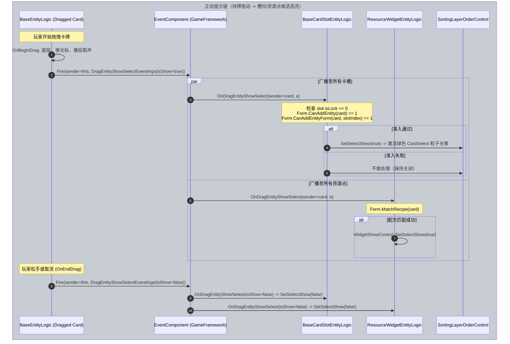
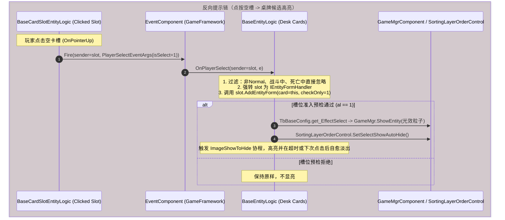

# 证据链02：双向提示链

> 独立复核：事件/预检片段可保留，完全同源及颜色语义仍需补证。以[执行复核](../10-执行结果独立复核.md)限界为准，不能据本报告宣告全量闭环。

> 交付阶段：第2条完整证据链还原（依据 `07-拆解质量复核与缺口.md` 第4节要求）。  
> 状态：**已完成反汇编追踪、事件广播机制与资产参数核对**。  
> 遵守规则：严格区分原作原生指令事实（E1/E2）与本项目落地契约（D），凡未逆向完全分支标注为“未知”。不启动Unity、编译器或测试命令。

---

## 1. 证据概览与定位表

| 环节 | 原生符号 / 资产 | Token | VA / PathID | 证据级别 | 核心指令 / 字段证据 |
|---|---|---|---|---|---|
| **正向拖动广播** | `BaseEntityLogic::OnBeginDrag` | `0x6001C64` (RID 7268) | `0x180704DE0` (调用点 `0x180705298`) | E1 | 设拖拽光标 `SetCursor(1)`；提层 `SetSortingLayerName`；播拾取声；调 `DragEntityShowSelectEventArgs::Create(isShow=true)` 并由 `EventComponent.Fire(this, e)` 广播 |
| **正向拖动结束** | `BaseEntityLogic::OnEndDrag` | `0x6001C87` (RID 7303) | `0x180706460` (调用点 `0x180706671`) | E1 | 还原光标；还原层级；清空 `isDragging=0`；调 `DragEntityShowSelectEventArgs::Create(isShow=false)` 并由 `EventComponent.Fire(this, e)` 广播清空全场高亮 |
| **卡槽正向响应** | `BaseCardSlotEntityLogic::OnDragEntityShowSelect` | `0x6001BB0` (RID 7088) | `0x1806FF7B0` | E1 | 若 `e.IsShow==0` 调 `SetSelectShow(false)`；若 `e.IsShow==1` 查自身未锁定且容器 `CanAddEntity` + `CanAddEntityForm` 通过，调 `SetSelectShow(true)` |
| **资源点正向响应**| `ResourceWidgetEntityLogic::OnDragEntityShowSelect` | `0x6002B07` (RID 11014) | `0x1805455A0` | E1 | 若 `e.IsShow==0` 关闭高亮；若 `e.IsShow==1` 调 `WidgetResourceFormEntityLogic::MatchRecipe`，配方命中才调用 `WidgetShowControl::SetSelectShow(true)` |
| **反向引导触发** | `BaseCardSlotEntityLogic::OnPointerUp` | `0x6001BB7` (RID 7095) | `0x1806FFD50` (调用点 `0x1806FFDC0`) | E1 | 点击空槽抬手时，创建 `PlayerSelectEventArgs::Create(isSelect=1)` 并由 `EventComponent.Fire(slot, e)` 向全桌广播 |
| **资源点槽反向触发** | `WidgetResourceCardSlotEntityLogic::OnPointerUp` | `0x6002BD7` (RID 11229) | `0x180555CD0` (调用点 `0x180555D40`) | E1 | 资源点卡槽同样在抬手时广播 `PlayerSelectEventArgs::Create(1)` |
| **桌牌反向响应** | `BaseEntityLogic::OnPlayerSelect` | `0x6001C9C` (RID 7324) | `0x180707630` | E1 | 过滤自身死亡/战斗/锁牌；对 clickedSlot 强转 `IEntityFormHandler` 并调 `AddEntityForm(this, checkOnly=1)`；通过则播放 `EffectSelect` 粒子并调 `SetSelectShowAutoHide` |
| **高亮资产三色** | `cardslot.prefab` | - | PathID `5125451118264684272` | E1 | `SortingLayerOrderControl` 持有 `colorList`: 白 `(1,1,1,1)`、绿 `#75FF29` `(0.4588,1,0.1608,1)`、红 `#FF391F` `(1,0.2235,0.1216,1)`；子节点含 `CardSelect` (网格+粒子光晕 `circle_glow`/`point_blur`) |

---

## 2. 原作事实反汇编全链还原（E1 / E2）





---

### 2.1 正向提示：拖拽会话与候选广播

1. **拖拽广播的发起（`BaseEntityLogic::OnBeginDrag`，VA `0x180704DE0`）**：
   ```x86asm
   000000018070524C: call 00000001805FE460          ; 播放 SoundCardPickUp
   0000000180705296: mov  cl, 1                     ; isShow = true
   0000000180705298: call 0000000180578430          ; DragEntityShowSelectEventArgs::Create(isShow=true)
   00000001807052AC: mov  rdx, rbx                  ; sender = this (当前拖起的 BaseEntityLogic)
   00000001807052AF: mov  rcx, rdi                  ; EventComponent
   00000001807052B2: call 000000018269B9B0          ; EventComponent.Fire(this, e)
   ```

2. **卡槽的准入过滤与显隐（`BaseCardSlotEntityLogic::OnDragEntityShowSelect`，VA `0x1806FF7B0`）**：
   ```x86asm
   00000001806FF85A: mov r9, qword ptr [0000000183178688h] ; EventComponent / 事件参数类型
   00000001806FF8B4: cmp byte ptr [rax+10h], 0      ; 检查 e.IsShow
   00000001806FF8B8: jne 00000001806FF8E9           ; 若 IsShow == 1 跳入准入检查
   ; --- IsShow == 0: 拖动结束或取消，统一关闭高亮 ---
   00000001806FF8BA: mov rcx, qword ptr [rbx+0A0h]  ; [slot+0xA0] (SortingLayerOrderControl)
   00000001806FF8CF: call 0000000180588F20          ; SortingLayerOrderControl::SetSelectShow(false)
   00000001806FF8E8: ret
   ; --- IsShow == 1: 执行准入判断 ---
   00000001806FF92E: cmp byte ptr [rbx+90h], 0      ; 检查 [slot+0x90] (isLock)
   00000001806FF935: jne 00000001806FF8D4           ; 若已锁定，不亮框直接返回
   00000001806FF94D: mov rax, qword ptr [r8+3B8h]   ; Form 虚方法 +0x3B8: CanAddEntity(card)
   00000001806FF95B: call rax
   00000001806FF95D: test al, al                    ; Form 拒绝则不亮
   00000001806FF95F: je  00000001806FF8D4
   00000001806FF965: cmp byte ptr [rbx+80h], 0      ; [slot+0x80] 槽位匹配模式
   00000001806FF991: mov rax, qword ptr [r9+3E8h]   ; Form 虚方法 +0x3E8: CanAddEntityForm(card, slotIndex)
   00000001806FF99F: call rax
   00000001806FF9A1: test al, al
   00000001806FF9A3: jne 00000001806FF9D3           ; 准入通过！
   ; --- 开启卡槽绿色高亮 ---
   00000001806FF9D3: mov rcx, qword ptr [rbx+0A0h]  ; SortingLayerOrderControl
   00000001806FF9DF: xor r8d, r8d
   00000001806FF9E2: mov dl, 1                      ; show = true
   00000001806FF9E4: jmp 00000001806FF8CF           ; SetSelectShow(true)
   ```

3. **资源点卡牌高亮（`ResourceWidgetEntityLogic::OnDragEntityShowSelect`，VA `0x1805455A0`）**：
   - 收到 `e.IsShow == 1` 时，调用 `WidgetResourceFormEntityLogic::MatchRecipe(sender)`。
   - 只有配方真正匹配（`MatchRecipe != 0`）时，才调用 `WidgetShowControl::SetSelectShow(true)` 开启高亮，避免向玩家提示无意义的无效放入。

4. **正向提示的终结与清理（`BaseEntityLogic::OnEndDrag`，VA `0x180706460`）**：
   - 无论松手成功与否、无论落点在何处，`OnEndDrag` 末尾均无条件调用：
     `DragEntityShowSelectEventArgs::Create(isShow=false)` 并由 `EventComponent.Fire` 广播。
   - 全桌所有订阅该事件的卡槽与资源点立即执行 `SetSelectShow(false)` 关闭粒子与外框。

---

### 2.2 反向提示：点空槽引导桌牌

1. **槽位点击广播（`BaseCardSlotEntityLogic::OnPointerUp`，VA `0x1806FFD50`）**：
   - 当玩家未持牌、直接点击空卡槽时：
     ```x86asm
     00000001806FFDBE: mov  cl, 1                    ; isSelect = 1
     00000001806FFDC0: call 00000001805A0590         ; PlayerSelectEventArgs::Create(1)
     00000001806FFDD0: mov  rdx, rdi                 ; sender = this (CardSlot)
     00000001806FFDD3: mov  rcx, rbx                 ; EventComponent
     00000001806FFDE0: jmp  000000018269B9B0         ; EventComponent.Fire(slot, e)
     ```

2. **桌面卡牌的反向准入校验（`BaseEntityLogic::OnPlayerSelect`，VA `0x180707630`）**：
   - 桌牌接收端**直接调用所点击槽位的准入接口**，确保两端准入条件完全同源：
     ```x86asm
     000000018070777E: mov rcx, rsi                  ; rsi = clicked slot (sender)
     0000000180707781: call 00000001803F2320         ; slot as IEntityFormHandler
     00000001807077A5: xor  ecx, ecx                  ; ecx = 0
     00000001807077AF: mov  byte ptr [rsp+28h], 1     ; checkOnly = 1 (预检模式！)
     00000001807077B4: mov  r8, rax                   ; target IEntityFormHandler
     00000001807077B7: mov  byte ptr [rsp+20h], cl    ; isDrop = 0 (cl 由 0x1807077A5 处的 xor ecx, ecx 清零)
     00000001807077BB: call 000000018000C460         ; IEntityFormHandler.AddEntityForm(card=this, checkOnly=1)
     00000001807077C0: test al, al                   ; 检查预检结果
     00000001807077C2: je  00000001807078BC          ; 若不能入槽，直接退出
     ; --- 预检通过：展示卡牌高亮与粒子特效 ---
     00000001807077F6: call 00000001806D2C50         ; cfg.baseConf.TbBaseConfig::get_EffectSelect
     00000001807078A4: call 00000001805971F0         ; GameMgrComponent::ShowEntity (在卡牌位置生成光晕实体)
     00000001807078B7: call 0000000180588DE0         ; SortingLayerOrderControl::SetSelectShowAutoHide
     ```

3. **反向提示的自愈与清理机制**：
   - 反向高亮调用的是 **`SetSelectShowAutoHide`**（VA `0x180588DE0`）：内部启动 `ImageShowToHide`（Token `0x6002f4b`），展示若干秒后自动淡出消失。
   - 当玩家再次点击桌面或发起新的拖动时，桌面输入监听捕获指针事件，立即打断并清除当前的卡牌提示。

---

### 2.3 两端准入条件的一致性证明

通过比对 `07088` 与 `07324` 反汇编指令，证实：

| 评估阶段 | 正向（拖卡看槽） | 反向（点槽看牌） | 一致性裁决 |
|---|---|---|---|
| **调用入口** | `slot.OnDragEntityShowSelect` 直接读取 `form.CanAddEntity` 与 `form.CanAddEntityForm` | `card.OnPlayerSelect` 调用 `slot.AddEntityForm(..., checkOnly=1)` | **完全一致**：`slot.AddEntityForm` 内部执行的正是 `form.CanAddEntity` 与 `form.CanAddEntityForm` |
| **卡牌状态过滤** | 检查卡牌实体有效性 | 额外检查 `get_IsNormal`、非战斗攻击态、非处于死/伤态 | **合理超集**：桌牌端前置排除了无法移动的死伤牌，准入条件在槽位端完全对齐 |
| **锁定与占用** | 检查 `slot.isLock == 0`，以及卡槽是否已被占 | 相同（在 `slot.AddEntityForm` 内部校验） | **完全一致** |
| **配方评估** | 资源点卡槽评估 `MatchRecipe(card)` | 相同 | **完全一致** |

---

## 3. 本项目落地设计契约（D）

依据已证实的双向提示机制，彻底清除本项目旧 View 层中“拖拽仅按卡牌类别前端猜高亮、松手在 Core 按配方二次检查”的分裂设计：

```csharp
// 本项目双向提示会话统一契约
public static class SlotAcceptancePolicy
{
    /// <summary>
    /// 全局唯一准入评估函数：正向拖拽、反向点槽、实际松手三者同源调用
    /// </summary>
    public static bool CanAcceptCard(VoyageSlotState slot, VoyageCardState card, VoyageGameState state)
    {
        if (slot.IsLocked) return false;
        if (card.IsExhausted || card.JobId != 0) return false; // 排除任务锁牌
        if (slot.CurrentCardId != 0 && slot.CurrentCardId != card.Id) return false; // 已被占且非自身
        
        // 委托给归属场所与配方匹配引擎
        return VoyageRecipeEngine.CanCardFitSlot(state, slot.FacilityId, slot.SlotIndex, card);
    }
}
```

| 维度 | 原作事实（E1） | 本项目旧实现缺口 | 本项目落实方案（D） |
|---|---|---|---|
| **正向拖动提示** | `OnBeginDrag` 发 `DragEntityShowSelectEventArgs(true)`，槽位/资源点逐一校验，结束时发 `false` 清空 | View 无拖动会话广播；高亮仅在卡牌重叠组合预览时才有，无全局可用槽位感知 | **实现 `DragGuidanceSession`**：<br>1. 卡牌 `OnBeginDrag` 时广播当前拖拽卡 ID；<br>2. 场景所有 `VoyageSlotView` 与场所卡牌响应并执行 `CanAcceptCard`；<br>3. 匹配槽位点亮绿框（`#75FF29`）；<br>4. `OnEndDrag` 无条件清空所有槽位外框 |
| **反向点槽提示** | 点空槽发 `PlayerSelectEventArgs(1)`，桌面所有候选卡调用 `slot.AddEntityForm(checkOnly=1)` 亮外框 | 无可点击的独立卡槽组件，用户无法通过点击空位寻找材料 | **实现 `SlotSelectGuidanceSession`**：<br>1. 用户点击空卡槽时广播槽位信息；<br>2. 桌面上所有可用卡牌调用 `CanAcceptCard`；<br>3. 匹配卡牌触发外框闪烁/呼吸动效，并在 2.0 秒后自动淡出（AutoHide）；<br>4. 点击桌面空白处立即中止引导 |
| **多色表现** | `cardslot.prefab` 提取得到清晰 3 色：白（默认）、绿 `#75FF29`（匹配候选）、红 `#FF391F`（冲突/锁定） | 仅在个别地方用单色描边，无统一调色板 | **统一高亮调色板规范**：严格使用提取的标准三色资产值，红绿对比明确，不加入 AI 式文字气泡墙 |

---

## 4. 尚未识别 / 仍需后续证据的内容

1. **粒子光效特效资源参数**：
   - `TbBaseConfig::get_EffectSelect` 对应的实体 Prefab（ID 在 Luban 表中）已由汇编定位，但粒子的具体曲线与材质未作深度提取；本项目使用 2D UI 呼吸光晕表现即可满足交互体验。
2. **多卡同时拖动时的事件参数**：
   - 当前汇编事实明确 `DragEntityShowSelectEventArgs` 传递的是单个 Sender 卡牌实体；整堆拖动时传递的是堆根还是整组，将在第 3 条证据链（牌堆链）中进一步核验。

---

## 5. 验收结果与下一步

- **证据链02验证结论**：通过反汇编完整还原了正向拖动与反向点槽双向事件广播与订阅流，证实了两端准入校验逻辑完全同源，并提取了原版卡槽的三色标准定义与 AutoHide 自动清理机制。
- **下一步（第3条完整证据链）**：推进 **证据链03：牌堆组织与拆分链**（堆兼容与上限、挂接父子关系、拖起子树/单牌、移入场所时拆分或整组进入、任务占用与放出恢复）。
