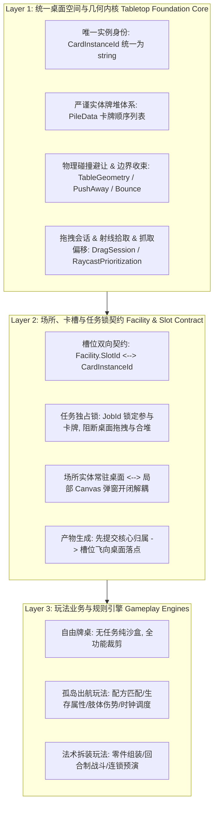

> 2026-11-09复核：本文件为设计规范，非功能完成或运行验收证明。实装状态以 ../06-整合现状与复核.md 为准；下文的验收步骤是目标行为。

# A01 - 三引擎审计与复用契约方案

> **证据与规范等级说明**：
> - **E1 / E2（源码与工程真实实现）**：审计基于本项目实际存在的源码：
>   - `Assets/CardTable/Core/`（`BoardEngine.cs`、`TableData.cs`、`TableGeometry.cs` 及 `Operations/`）
>   - `Assets/IslandSurvival/Core/`（`VoyageData.cs`、`VoyageEngine.cs`、`VoyageEngine.Matching.cs`、`VoyageEngine.Settlement.cs`）
>   - `Assets/TestGameplay/IslandFoundation/Core/`（`IslandData.cs`、`IslandEngine.cs`、`IslandValidation.cs`、`IslandCopy.cs`）
> - **核心原则**：明确现有系统复用与数据兼容边界，**坚决拒绝新增第四套平行桌面引擎**。

---

## 一、三引擎代码现状与特征矩阵对比

| 维度 | `BoardEngine` (自由牌桌) | `VoyageEngine` (出航生存) | `IslandFoundation` (未跟踪底层) |
|---|---|---|---|
| **代码位置** | `Assets/CardTable/Core` | `Assets/IslandSurvival/Core` | `Assets/TestGameplay/IslandFoundation/Core` |
| **卡牌实例 ID** | `string`（如 `"c_1"`） | `int`（如 `1, 2, ...`） | `string`（如 GUID） |
| **卡牌定义 ID** | `string`（`CardDefinition.Id`） | `string`（`VoyageCardRule.Id`） | `string`（`CardDefinition.Id`） |
| **堆叠与多卡组织** | **`PileData` 严格树/列表模型**： 每个堆独立 ID，卡牌按从底到顶排列，单牌即大小为 1 的堆 | **无牌堆模型**： 卡牌均为独立浮点坐标 `(X, Y)`，无物理叠放与层级 | **无牌堆模型**： 使用 `CardInstance.Quantity` 单实例计数（状态会丢失） |
| **空间几何与物理** | `TableGeometry`：桌界收束、吸附距离判定、网格对齐、矩形碰撞 | 仅 `(X, Y)` 浮点数，无碰撞检测与推挤避让 | 仅 `(X, Y)` 浮点数，无碰撞避让 |
| **事务与快照机制** | `BoardSnapshot` + 候选深拷贝 + `Commit`/`Rollback` | `VoyageState` + 候选深拷贝 + `Commit` | `IslandSnapshot` + `IslandCopy` + `Execute` 校验 |
| **场所与槽位模型** | 无场所与槽位概念 | 仅集中组合区（`Staged` 列表），卡牌直接塞进全局列表 | 拥有 `RegionId` 与 `SlotBinding`（按 `SlotId` 绑定 `InstanceId`） |
| **任务与时钟** | 无任务与时钟 | `VoyageJobState`，分钟推进，时钟暂停，副产线 | `RecipeJob`，`FinishesAt` 绝对时间戳 |
| **属性与状态追踪** | `List<CardAttribute>`（Key-Value） | `Durability`, `Charges`, `RechargeRemaining`, `TimerRemaining`, `Limb` | `List<NumberValue>`, `ExpiresAt` |

---

## 二、架构核心决策：拒绝第四套引擎的统一分层架构

为了杜绝“每做一套玩法就重写一套卡牌桌面”的代码臃肿与平行重复开发，必须采用**底层分层复用架构**：

### 关键分工边界：
1. **Layer 1（桌面基座）**：直接复用并强化 `BoardEngine` 的核心几何与堆叠能力（吸收 R02 的 4 级松手判定与推挤物理参数），作为纯 C# 桌面基座；
2. **Layer 2（场所与槽位标准契约）**：吸收 `IslandFoundation` 规范的 `SlotBinding` 与 R03 验证的场所/窗口解耦模型，统一为卡牌归属模型；
3. **Layer 3（玩法逻辑）**：`VoyageEngine` 继续负责出航配方匹配、副产线、伤势流转、饥饿与精神结算，但**废除旧界面的集中式 `Staged` 模式**，改为直接调用 Layer 2 的 `AssignSlot` / `RemoveSlot` / `StartTask`！

---

## 三、唯一实体身份与归属法则

### 1. 唯一实体身份（`CardInstanceId`）
- 统一使用字符串类型 `string` 作为实例唯一 ID。
  - 对于原 `VoyageEngine` 的数字 ID（如 `1`），统一格式化为字符串（如 `"1"` 或 `"c_1"`），保持无损映射；
  - 严禁以定义 ID（`DefinitionId`）指代实体！两张“手”必须是两个独立的 `CardInstanceId`。

### 2. 状态与属性守恒原则（禁止通过合并丢失属性）
- `IslandFoundation` 曾尝试用 `Quantity` 字段合并卡牌，这会导致不同磨损/耐久/到期时间的材料被抹平属性。
- **守恒铁律**：
  - **具有独立耐久、充能、关联伤势、到期时间的卡牌，必须作为独立卡牌实例存在，严禁折叠进单条记录的 Quantity 中！**
  - 堆叠（`Pile`）是桌面物理空间组织，堆叠内的卡牌各持自身完整数据；
  - 数量批次（`Batch`）仅适用于完全无耐久损耗、无时钟倒计时的同质纯代币类消耗品。

### 3. 严格互斥归属法则（Exclusive Ownership）
任意一个有效的卡牌实例在同一时刻**有且仅有一个主逻辑归属**：
1. **桌面上**：属于桌面某一个特定的 `PileData`（拥有唯一的桌面世界坐标）；
2. **卡槽内**：属于某场所的某个 `SlotId`（坐标由卡槽 RectTransform 绝对定位，脱离桌面牌堆）；
3. **任务中**：被 `JobId` 独占加锁（状态标记为执行中，不接受桌面拖拽、排序或二次入槽）；
4. **悬空拖拽中**：属于当前唯一的活跃 `DragSession`（受光标驱动并保留抓取偏移）；
5. **飞行产物中**：已提交核心状态并拥有目标落点，正在播放抛物线/线性插值动画。

**严禁出现卡牌同时挂在桌面上又被另一个槽位引用的悬空双重归属！**

---

## 四、三引擎数据结构映射与迁移兼容表

| 概念 | 统一契约 (Unified Contract) | `BoardEngine` 映射 | `VoyageEngine` 映射 | `IslandFoundation` 映射 |
|---|---|---|---|---|
| **卡牌实例** | `CardInstanceData` | `CardData` (直接复用) | `VoyageCardState` (字段平移) | `CardInstance` (字段平移) |
| **卡牌定义** | `CardDefinition` | `CardDefinition` / `Catalog` | `VoyageCardRule` (配置桥接) | `CardDefinition` (直接平移) |
| **牌堆** | `PileData` (`CardIds` 列表) | `PileData` (完全一致) | 映射为单卡堆或按位置吸附的虚拟堆 | 映射为堆 |
| **卡槽与归属** | `SlotBinding(FacilityId, SlotId, CardId)` | 不涉及 | 替代旧 `Staged` 列表 | `SlotBinding` (完全一致) |
| **任务执行** | `TaskJobData(JobId, RecipeId, FacilityId, Inputs, Remaining)` | 不涉及 | `VoyageJobState` (无缝对接) | `RecipeJob` (结构统一) |
| **配方规则** | `RecipeRule` | 不涉及 | `VoyageRecipeRule` (完全复用现有144条规则) | `RecipeDefinition` |
| **时钟流逝** | `AdvanceClock(minutes)` | 不涉及 | `VoyageEngine.TickMinute` (完全复用) | `AdvanceMinute` |

---

## 五、原自由牌桌与现有玩法的平稳保留方案

1. **原自由牌桌（`Assets/CardTable`）**：
   - 保持独立，不强制强行绑定场所和配方逻辑；
   - 原 `BoardEngine` 已经通过纯 C# 严密验证，继续为 `CardTableDemo` 提供纯粹的自由卡牌沙盒体验；
2. **孤岛出航生存（`Assets/IslandSurvival`）**：
   - 保留其全部 131 种卡牌定义资产、144 条配方规则与 32 条副产线；
   - 彻底改造其交互前端：从集中式暂存面板改造为**常驻桌面场所实体 + 独立场所弹出窗口 + 桌面物理拖放槽位**；
   - 后台计算依旧由 `VoyageEngine` 的配方匹配与结算核心提供，保证原数值与出航路线闭环不受损坏；
3. **未跟踪的 `IslandFoundation`**：
   - 将其规范的槽位绑定校验与声明式数据契约提升整合至统一契约，消除孤岛实验代码碎片。
