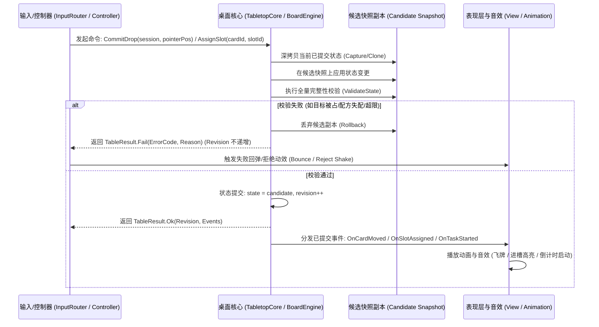

> 2026-11-09复核：本文件为设计规范，非功能完成或运行验收证明。实装状态以 ../06-整合现状与复核.md 为准；下文的验收步骤是目标行为。

# A02 - 统一命令、查询与事件契约规范

> **证据与设计等级**：
> - **E2 / D（架构规范与代码接口契约）**：基于 A01 确立的“拒绝第四套引擎”三层分层复用架构，对 Layer 1（桌面基座）与 Layer 2（场所卡槽）之间的命令流、查询流、事件流及原子事务规范进行严格冻结。
> - **核心准则**：输入与表现层绝对禁止绕过核心私自修改卡牌归属与坐标；核心操作遵循“候选副本校验 → 一次性原子提交”；失败绝对不扣料、不位移、不递增版本号。

---

## 一、事务流与状态版本控制机制



### 1. 状态版本号（`Revision`）
- 初始版本为 `0`；
- 每次成功提交（`Commit`）严格 `Revision++`；
- 查询操作（`QueryDrop`、`QueryCandidates`）不改变 `Revision`；
- 表现层与 UI 仅在 `Revision` 发生递增且包含当前关注对象变更时才重绘局部视图，杜绝每帧无谓刷新。

---

## 二、统一命令结果结构（`TableResult`）

所有修改核心状态的命令必须统一返回 `TableResult`：

```csharp
namespace CardKKK.Tabletop.Core
{
    public sealed class TableResult
    {
        public bool Success { get; }
        public string ErrorCode { get; }
        public string Message { get; }
        public int Revision { get; }
        public IReadOnlyList<ITableEvent> Events { get; }

        private TableResult(bool success, string errorCode, string message, int revision, IReadOnlyList<ITableEvent> events)
        {
            Success = success;
            ErrorCode = errorCode ?? "";
            Message = message ?? "";
            Revision = revision;
            Events = events ?? Array.Empty<ITableEvent>();
        }

        public static TableResult Ok(int revision, IReadOnlyList<ITableEvent> events = null)
        {
            return new TableResult(true, "", "", revision, events);
        }

        public static TableResult Fail(string errorCode, string message, int currentRevision)
        {
            return new TableResult(false, errorCode, message, currentRevision, null);
        }
    }
}
```

### 核心错误码表（Error Codes）
| 错误码 | 触发场景 | 用户反馈文案（遵循 Humanizer，保留具体原因） |
|---|---|---|
| `CardLockedInJob` | 试图拖动或操作正在执行任务的卡牌 | “这张牌正在工作中，无法移动。” |
| `SlotOccupied` | 试图将卡牌放入已有卡牌的卡槽 | “该槽位已被占用。” |
| `SlotTypeMismatch` | 卡牌类型与卡槽标签要求不匹配 | “此卡槽需要具备 [{0}] 标签的卡牌。” |
| `StackLimitReached` | 目标堆叠已达上限（如 20 张） | “牌堆已达到最大容量。” |
| `StackRuleViolation` | 违反堆叠规则（不同族系/不同定义） | “该卡牌无法与此牌堆堆叠。” |
| `DeskBoundsExceeded` | 落点超出桌面有效边界且避让无解 | “无法将卡牌放置在桌面边界之外。” |
| `RecipeNotFound` | 投入材料未匹配到任何已知或隐藏配方 | “当前材料组合没有可执行的配方。” |
| `FacilityBusy` | 场所已有正在进行的任务 | “该设施正在运转中，请等待其完成。” |

---

## 三、只读查询契约（Read-only Queries）

查询接口严禁修改核心状态，仅做计算并返回不可变评估结果。

### 1. 落点判定评估（`QueryDrop`）
```csharp
public sealed class DropEvaluation
{
    public DropPriority Priority { get; set; }           // UI / FormSlot / SnapSlot / CardStack / FreeDesk
    public string TargetId { get; set; }                 // 槽位 ID、堆 ID 或场所 ID
    public TablePoint TargetPosition { get; set; }       // 建议吸附或避让后的最终落点
    public bool IsValid { get; set; }                   // 是否合法允许松手
    public string RefusalReason { get; set; }            // 不合法时的具体拒绝原因
    public DropActionType ActionType { get; set; }       // InsertSlot / MergeStack / EvadeDesk / Reject
    public HighlightFeedback FeedbackColor { get; set; } // None / GreenReady / RedReject
}
```

### 2. 配方与槽位候选查询（`QueryCandidates`）
- `QueryEligibleCardsForSlot(string facilityId, string slotId)`：
  - 自动遍历桌面所有空闲卡牌（排查已被锁定、正在工作、处于死亡状态的卡牌）；
  - 根据该槽位的标签过滤器（`RequiredTags`）或定义约束进行筛选；
  - 返回高亮候选列表，驱动表现层做局部卡槽绿色悬停反馈（`C03`）。

---

## 四、核心表现事件（Table Events）

核心状态提交后，通过事件流通知表现层驱动动画，表现层严格作为“状态的投影”。

| 事件类型 | 携带数据 | 表现层动画响应 |
|---|---|---|
| `CardMovedEvent` | `CardId`, `FromPos`, `ToPos`, `Duration` | 线性/平滑缓动位移（`DoTween` / 协程平滑插值） |
| `CardStackedEvent` | `CardId`, `TargetPileId`, `IndexInPile` | 牌堆对齐，层级更新（`SortingOrder`），微弱吸附下落弹性 |
| `SlotAssignedEvent` | `CardId`, `FacilityId`, `SlotId` | 从桌面抓取脱离，落入窗口卡槽 RectTransform 锚定，触发入槽音效 |
| `SlotRemovedEvent` | `CardId`, `FacilityId`, `SlotId`, `DeskPos` | 从卡槽拔出，恢复桌面 `Transform` 挂载，弹出至桌面空位 |
| `TaskStartedEvent` | `JobId`, `FacilityId`, `RecipeId`, `DurationMinutes` | 场所实体 `timer_progress` 进度条开启，窗口开始倒计时 |
| `TaskCompletedEvent`| `JobId`, `FacilityId`, `RecipeId`, `Outputs` | 进度条清空，场所高亮闪烁，触发产物生成链路 |
| `CardDetachedFlyEvent`| `CardId`, `SpawnSlotPos`, `TargetDeskPos`, `ArcHeight` | 产物从场所 `cardGrid` 解绑，沿抛物线弹飞至桌面落点（`Fly2Target`） |
| `CardsEvadedEvent` | `List<(CardId, FromPos, ToPos)>` | 桌面其它卡牌受推挤避让位移（`PushAwayFromOthers`） |

---

## 五、原子事务与回滚保障准则

1. **零污染准则（Zero-Pollution Rule）**：
   - 任何涉及多卡变动的操作（例如：拆堆放入卡槽、配方启动扣除 3 张材料、产物批量喷出 5 张新卡），必须打包在**单次原子提交**中；
   - 只要有 1 项校验不满足，整个操作立即全面回滚，原状态不做任何部分修改。
2. **所有权绝对单射（Bijection of Ownership）**：
   - 状态提交后，卡牌属于且仅属于一个容器（桌面堆 / 卡槽 / 任务锁定）；
   - 在任何一次状态提交后的完整性校验（`ValidateState`）中，一旦检测到某张卡牌同时出现在两个容器，或出现父子引用成环，立即抛出致命异常并回滚。
3. **表现与核心脱耦**：
   - 产物飞行动画中途，若玩家强行关闭游戏或保存存档，由于核心状态在起飞前已明确提交了卡牌的桌面最终位置，重新读档时卡牌直接稳定呈现在桌面落点，绝不产生“飞在半空中的死锁悬空牌”。
