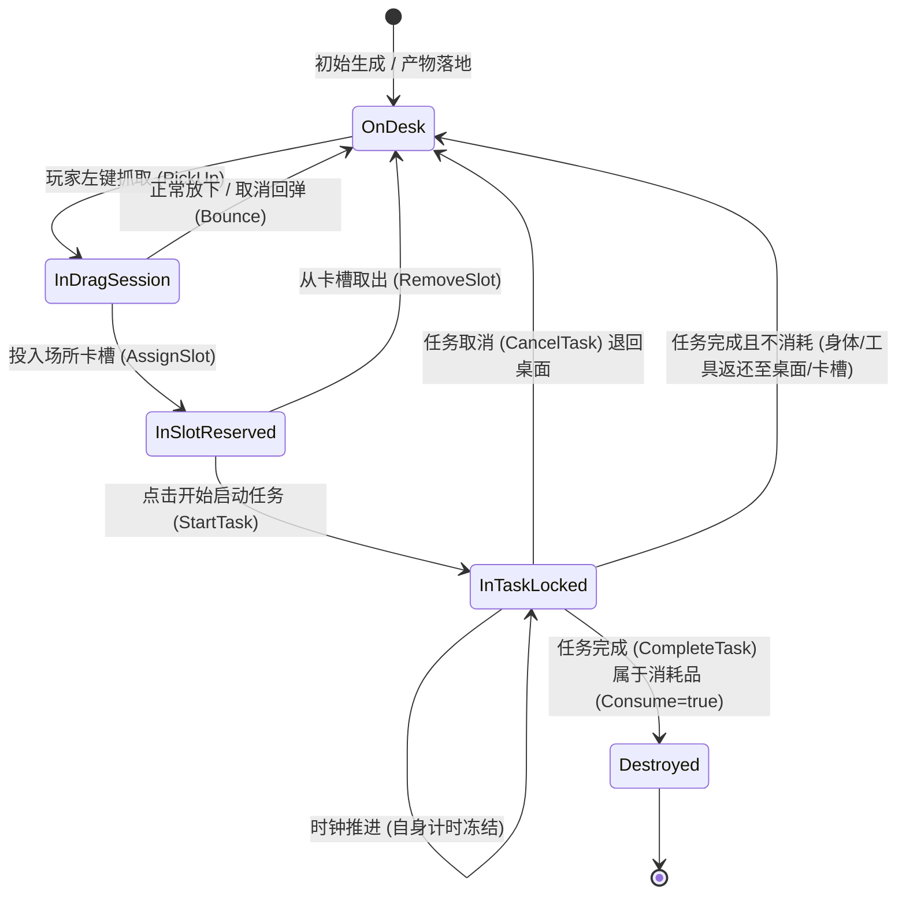

> 2026-11-09复核：本文件为设计规范，非功能完成或运行验收证明。实装状态以 ../06-整合现状与复核.md 为准；下文的验收步骤是目标行为。

# A04 - 实例预留、任务锁与消耗生命周期校验规范

> **规范等级**：
> - **E2 / D（纯 C# 核心状态机与校验逻辑规范）**：定义卡牌在卡槽预留、任务加锁、消耗扣料、耐久磨损、返还与销毁全生命周期的不变量与事务校验。
> - **核心准则**：一张牌在同一物理/逻辑时刻绝对不能同时位于两个卡槽或参与两个任务；取消与完成操作具有严格幂等性，各仅能成功提交一次。

---

## 一、卡牌全生命周期状态机

---

## 二、实例互斥预留与任务锁（TaskLock）契约

### 1. 槽位预留（Slot Reservation）
当卡牌被放置进某场所的卡槽（`AssignSlot`）但任务尚未点击启动时：
- 该卡牌被记录为该场所该槽位的预留卡（`SlotBinding`）；
- 核心状态标记 `Card.BindingSlot = (FacilityId, SlotId)`；
- 物理桌面将其排除在射线检测与碰撞计算之外；
- 其它任何场所的卡槽再次尝试吸附该卡牌时，核心校验直接拦截并返回 `CardAlreadyReserved`。

### 2. 独占任务锁（TaskLock）
当玩家点击“开始”按钮或满足自动启动条件时：
- 核心原子事务将槽位绑定的卡牌全部打上 `LockedByJobId = jobId`；
- **锁状态铁律**：
  1. **拖拽免疫**：光标无法拾取该卡牌；
  2. **候选隔离**：全桌配方候选与高亮查询（`QueryCandidates`）自动过滤该卡牌；
  3. **寿命冻结**：根据出航版核心规则，进入生产/加工/研究任务中的卡牌，其自身的腐蚀/寿命/磨损计时器（`TimerRemaining`）**立即冻结**，杜绝卡牌在任务执行中途因腐败自毁而导致逻辑死锁；
  4. **合堆与整理阻断**：整理桌面（Tidy）或自动合堆操作自动忽略被锁定的卡牌。

---

## 三、消耗、磨损、返还与销毁统一处理准则

在任务结算（`CompleteTask`）时，核心一次性原子遍历输入槽内绑定的全部卡牌实例：

| 投入材料特性 | 结算行为 | 状态变更与表现事件 |
|---|---|---|
| **一次性消耗品** (`Consume == true`) | 彻底扣除并注销 | 1. 从所有索引和数据列表中抹除； 2. 释放 `CardInstanceId`； 3. 触发表现层 `CardConsumedEvent`（淡出/粉碎动效）。 |
| **可损耗工具/容器** (`DurabilityCost > 0`) | 扣除耐久并返还 | 1. `Durability -= DurabilityCost`； 2. 若 `Durability > 0`：解锁并弹出至桌面/保留在槽； 3. 若 `Durability <= 0`：触发转化（如变残骸）或直接销毁。 |
| **身体/永固牌** (`Consume == false`) | 解除任务锁并返还 | 1. 清除 `LockedByJobId = 0`； 2. 身体牌解除占用，可被后续任务使用； 3. 触发 `CardSlotRemovedEvent` 或留在主槽等待下一次操作。 |

---

## 四、取消与完成的幂等性保护（Idempotency）

为防止快速双击、动画中途再次触发或网络/多线程重入：

1. **唯一状态断言（Pre-condition Assertion）**：
   - 任务完成时，断言 `Job.Remaining <= 0` 且 `Job.IsCompleted == false`。首次提交后立即将任务从活动任务字典移除，后续重复提交直接返回 `TaskAlreadyFinished`；
   - 任务取消时，断言 `Job.IsCancelled == false`。首次提交后立即回滚卡牌锁定状态，后续重复取消直接返回 `TaskAlreadyCancelled`。
2. **退路与保底方案**：
   - 若任务完成产生 5 张产物卡牌，但桌面因边界狭窄空间不足以放下，核心必须触发 `EvasionOrStackFallback`（优先合入兼容牌堆，若无兼容牌堆则就近螺旋寻找最近有效空位），严禁吞卡！
