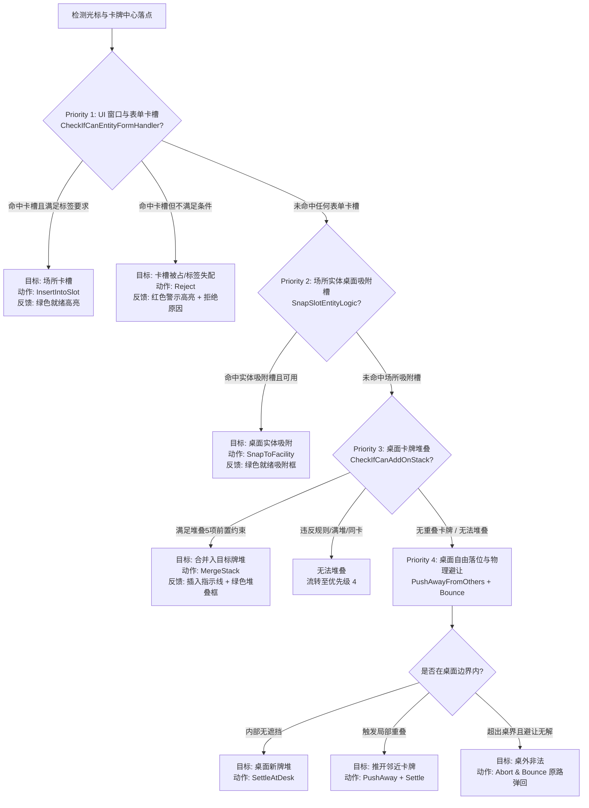

> 2026-11-09复核：本文件为设计规范，非功能完成或运行验收证明。实装状态以 ../06-整合现状与复核.md 为准；下文的验收步骤是目标行为。

# B03 - 统一落点判定、多对象命中优先级与遮挡规范

> **规范等级**：
> - **E1 / E2（物理射线检测与落点判定统一管线规范）**：将 R02 逆向发现的原生 4 级决策树与本项目多图层 UI 射线交互严密结合。
> - **核心准则**：预览（`Preview`）与提交（`Commit`）严格使用完全同一套判定流水线；悬停与松手判定结论绝对一致；拒绝接受时必须向玩家给出具体可解释的原因。

---

## 一、四级落点目标判定流水线（Strict 4-Tier Pipeline）

拖拽中的卡牌松开或每帧移动时，系统统一执行以下自顶向下的四级优先级判定：



---

## 二、遮挡剔除与最顶层命中法则（Topmost Hit Principle）

在桌面存在密集卡牌与堆叠时，必须严格确定“到底击中了谁”：

1. **渲染层级优先（Sorting Order Supremacy）**：
   - 射线检测返回的所有碰撞体，按其所属 GameObject 的实际渲染层级 `SortingOrder`（或 Canvas 下 `SetSiblingIndex`）自大到小严格排序；
   - 处于最上层的卡牌优先捕获光标事件。
2. **自身与拖拽集合剔除**：
   - 射线检测自动忽略当前处于 `DragSession` 内的所有卡牌及其碰撞体，防止卡牌“自己遮挡自己”。
3. **透明 UI 射线阻断治理**：
   - 全屏辅助 Panel、LayoutGroup 背景的 `Image` 必须显式取消勾选 `RaycastTarget`，严禁隐形透明层“隔空吞射线”；
   - 仅真正承载点击交互的按钮、卡面、卡槽与窗口边框保留 `RaycastTarget = true`。

---

## 三、锁定与不可交互对象处理

1. **任务锁定牌（Locked Cards）**：
   - 处于 `TaskLock` 状态的卡牌：
     - 作为拖动源：射线检测到后拒绝抓取，提示“该卡牌正在工作中”；
     - 作为拖放目标：拒绝其它卡牌堆叠到其上方，落点判定将其视为阻挡物，触发优先级 4 的物理避让（`PushAwayFromOthers`）。
2. **不可交互卡（如障碍物/背景地形）**：
   - 仅作为桌面占位实体，拒绝堆叠与入槽。

---

## 四、预览与提交双工一致性保障

在 `CardTableController` 中，实现落点判定的绝对同源：

```csharp
// 预览与提交调用同一个 Evaluation 引擎
public DropEvaluation EvaluateDrop(DragSession session, Vector2 pointerDeskPos)
{
    // 1. 检测是否处于任何活动场所窗口的卡槽上
    if (TryEvaluateFormSlot(session, pointerDeskPos, out var formSlotEval))
        return formSlotEval;

    // 2. 检测是否处于桌面常驻实体的吸附槽上
    if (TryEvaluateSnapSlot(session, pointerDeskPos, out var snapSlotEval))
        return snapSlotEval;

    // 3. 检测是否落在桌面其它兼容牌堆上
    if (TryEvaluateStacking(session, pointerDeskPos, out var stackEval))
        return stackEval;

    // 4. 自由桌面落点与避让计算
    return EvaluateDeskPlacement(session, pointerDeskPos);
}
```

- 拖拽每帧调用 `EvaluateDrop` 驱动绿色/红色边框渲染；
- 松手瞬间再次调用 `EvaluateDrop`，若合法则执行原子事务提交；若非法则触发原路平滑回弹。
