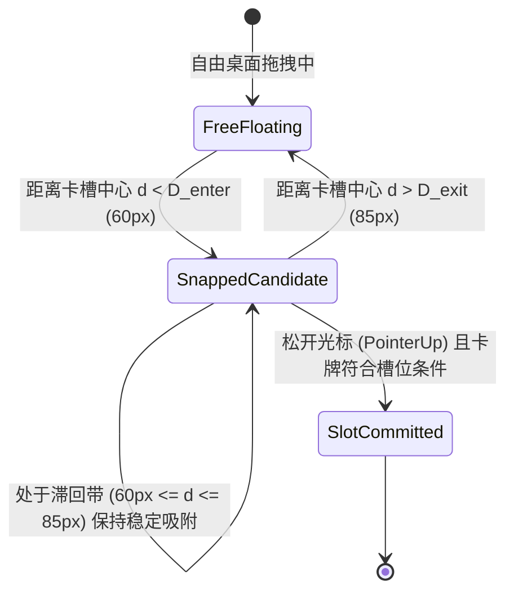
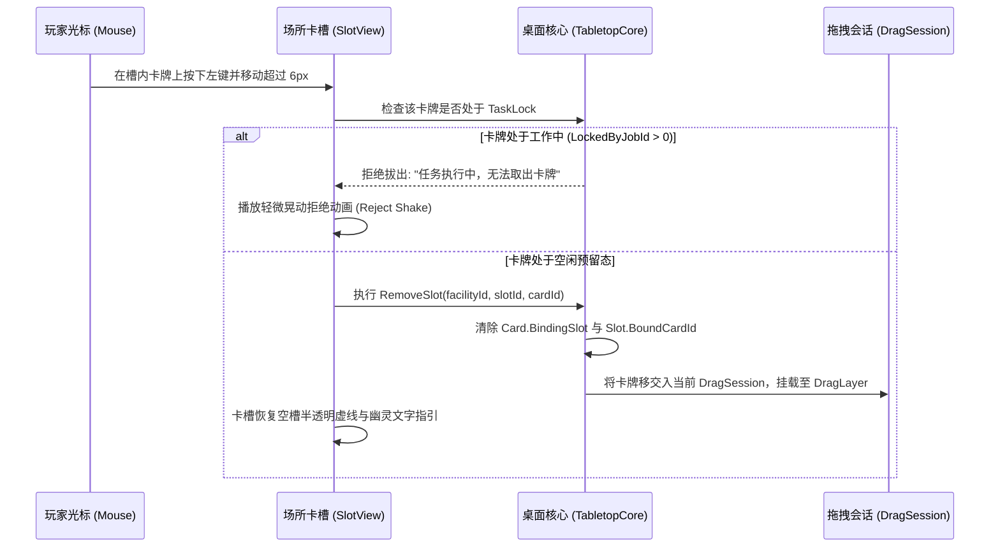

> 2026-11-09复核：本文件为设计规范，非功能完成或运行验收证明。实装状态以 ../06-整合现状与复核.md 为准；下文的验收步骤是目标行为。

# B06 - 槽位吸附、滞回防抖与解绑跟随规范

> **规范等级**：
> - **E2 / D（交互体验与几何吸附状态机规范）**：解决卡牌在接近卡槽或吸附槽边缘时光标轻微抖动导致的“反复吸附-脱离”高频闪烁，以及槽位解绑不彻底残留幽灵引用的核心问题。
> - **核心准则**：严格引入双阈值距离滞回（Hysteresis）；从卡槽拔出卡牌必须完整清理双向关联；目标失效或销毁时绝不允许残留僵尸绑定。

---

## 一、双阈值距离滞回机制（Hysteresis Snap Trigger）

为了消除在卡槽边缘由于像素微动引起的反复吸附与闪烁，吸附系统采用**施密特触发器（Schmitt Trigger）双阈值模型**：

- **吸附触发阈值（$D_{enter}$）**：$60\text{px}$。未吸附的卡牌必须靠近到 $60\text{px}$ 以内才被磁吸拉入吸附态；
- **脱离释放阈值（$D_{exit}$）**：$85\text{px}$。一旦进入吸附态，玩家必须明确拉开卡牌超过 $85\text{px}$ 才会断开吸附；
- **$25\text{px}$ 缓冲滞回带**：在 $[60, 85]\text{px}$ 区间内保持上一次状态不变，彻底杜绝高频闪烁。

---

## 二、槽位卡牌拔出与解绑流水线（Extraction Pipeline）

当玩家从场所卡槽中抓取已放入的卡牌时：

---

## 三、目标失效与外部注销自愈机制

1. **瞬时解绑保障**：
   - 当场所窗口被关闭、场所实体被移动、或者配方通过外部自动化流程强行结算时：
   - 核心自动触发 `ClearSlotBinding(slotId)`；
   - 校验槽位与卡牌的互反引用（`Slot.BoundCardId == Card.Id` 且 `Card.BindingSlot == Slot.Id`），只要有一方失效，立即单向清空并重置状态，杜绝幽灵死锁槽位。
