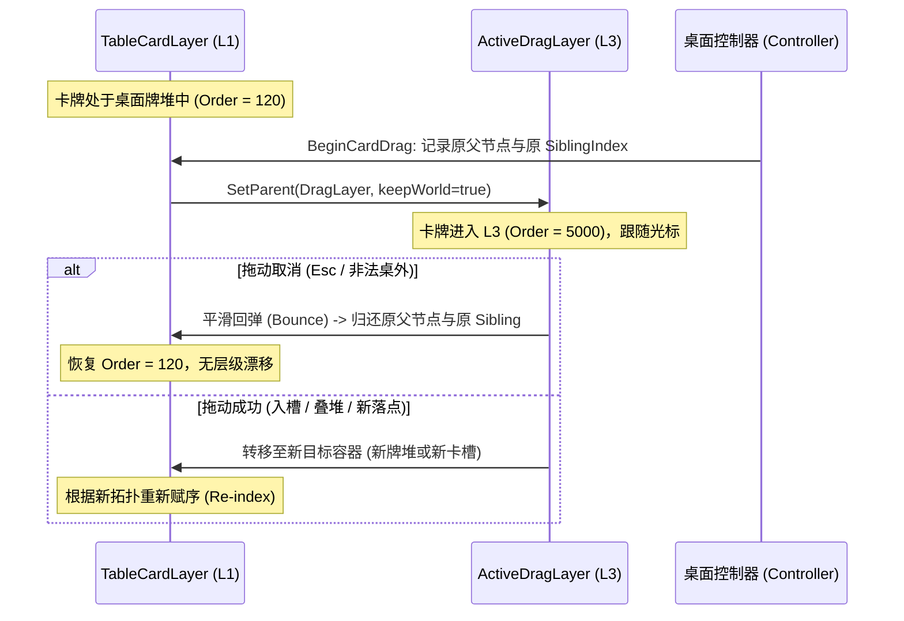

> 2026-11-09复核：本文件为设计规范，非功能完成或运行验收证明。实装状态以 ../06-整合现状与复核.md 为准；下文的验收步骤是目标行为。

# B07 - 渲染层级、高亮反馈与命中排序一致性规范

> **规范等级**：
> - **E2 / D（表现层图层体系与渲染/命中一致性规范）**：解决卡牌桌面上常见的“画在前面却点不到”、“抓起卡牌被其它卡牌遮挡”、“工具提示框遮挡下落卡槽”等核心交互缺陷。
> - **核心准则**：渲染层级与射线命中排序严格同序（所见即所点）；拉起的卡牌必须全局置顶；离开拖拽时卡牌必须精确复原至对应数据层级。

---

## 一、全局七层渲染与命中拓扑结构

系统规定严格的 7 级渲染层级体系（无论是在 2D Sprite 渲染管线还是 uGUI Canvas 模式下均保持相同数值区间）：

| 层级编号 | 图层名称 | SortingOrder / Sibling 范围 | 包含元素 | 交互与射线权限 |
|:---:|---|:---:|---|---|
| **L0** | `BackgroundLayer` | 0 | 暗色木质桌面背景、桌面网格参考线 | 不阻挡卡牌拖拽，承接相机平移 |
| **L1** | `TableCardLayer` | 100 ~ 2000 | 桌面静态卡牌、牌堆底座、常驻场所实体 | 正常桌面射线交互，堆内自底向上递增 |
| **L2** | `HoverElevatedLayer`| 3000 | 当前光标悬停或选中的卡牌/牌堆 | 局部置顶，绘制金色/绿色高亮外边框 |
| **L3** | `ActiveDragLayer` | 5000 | 正在被拖拽的卡牌组（主卡 + 子堆） | 全局置顶于所有桌面卡牌之上 |
| **L4** | `FacilityWindowLayer`| 7000 | 场所独立弹出的 Canvas 局部窗口与卡槽 | 窗口内部卡槽有最高点击优先级 |
| **L5** | `TooltipLayer` | 9000 | 悬停长文本卡牌详情框、配方说明 | 支持滚轮滚动；拖拽激活时自动淡出隐藏 |
| **L6** | `SystemModalLayer` | 10000 | Esc 系统菜单、设置弹窗、游戏结束面板 | 阻断一切下层输入，拥有独占焦点 |

---

## 二、拖拽生命周期的层级动态调度（Dynamic Layer Migration）

---

## 三、三色高亮与视觉状态编码（严格对齐 R01 证据）

根据 R01 中对 `SortingLayerOrderControl` 的反序列化恢复数据，系统严格规范以下三类反馈色彩：

1. **默认常规状态（Default Normal）**：
   - 边框色：`#FFFFFF` (1, 1, 1)
   - 无外发光，常规卡框展现。
2. **就绪与可吸附状态（Ready / Snap Target）**：
   - 边框与吸附指示色：`#75FF29` (0.4588, 1, 0.1608)
   - 当被拖拽卡牌悬停于满足条件的场所卡槽、或可合法堆叠的同类卡牌上方时触发。
3. **排斥与非法阻断状态（Reject / Illegal Block）**：
   - 边框与错误警示色：`#FF391F` (1, 0.2235, 0.1216)
   - 当悬停于不可用槽位、超出堆叠上限、或属性失配的卡牌上方时触发，伴随抖动提示并显示具体拒绝文案。

---

## 四、工具提示框（Tooltip）避让与自适应布局准则

1. **拖拽期间静默（Mute on Drag）**：
   - 一旦卡牌进入 `DragSession`，所有常驻卡牌的 Tooltip 立即淡出隐藏，绝不允许大面积半透明说明卡遮挡卡槽或落点；
2. **屏幕边缘自适应镜像（Screen Boundary Inversion）**：
   - 提示框锚点依据卡牌在屏幕视口中的象限动态计算：
     - 卡牌在屏幕右半侧：提示框朝左展开；
     - 卡牌在屏幕下半侧：提示框朝上展开；
   - 保证提示框 100% 完整显示在屏幕可视区域内，不切断文字、不遮挡当前卡牌本身。
