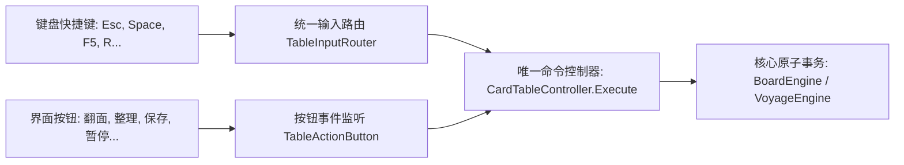

> 2026-11-09复核：本文件为设计规范，非功能完成或运行验收证明。实装状态以 ../06-整合现状与复核.md 为准；下文的验收步骤是目标行为。

# B08 - 输入屏蔽、异常中断保护与全状态自愈规范

> **规范等级**：
> - **E2 / D（输入安全路由与异常边界保护实现规范）**：覆盖拖拽中按 Esc、应用失焦、模态弹窗穿透、切场景注销、以及目标在操作瞬间销毁等各种极端边界。
> - **核心准则**：任何异常中断下绝对不产生悬空拖拽会话、无穿透点击、无死锁残留锁；按钮与快捷键严格共用统一命令控制器。

---

## 一、异常中断矩阵与全状态自愈策略

| 异常触发场景 | 核心拦截与保护行为 | 表现层反馈与状态自愈 |
|---|---|---|
| **拖拽中按下 Esc** | 触发 `CancelDrag`，立即结束拖动会话，不触发任何状态提交 | 卡牌从当前光标位置平滑回弹（`Bounce`）至原记录坐标；清除一切预览与高亮 |
| **拖拽中 Alt+Tab 失焦** (`OnApplicationFocus(false)`) | 自动触发安全终止，注销输入监听，清空鼠标抓取会话 | 瞬时对齐原位快照，防止卡牌因光标丢失而永久“挂在半空” |
| **打开模态系统菜单** | 设置 `PauseFlags.ModalMenuOpen`，激活全局透明遮罩层拦截桌面射线 | 牌桌底层进入只读冻结态，禁止抓取、禁止平移桌面、禁止快捷键穿透 |
| **拖拽中目标卡槽被销毁** (如配方完成自动关闭) | 松手时在 `Commit` 前重新核验目标 `TargetId` 的存在性与有效性 | 发现目标失效后立即自动降级为“自由桌面避让落位”或“原路回弹”，绝不吞牌 |
| **切换场景 / 退出桌面** (`OnDestroy` / `Unbind`) | 统一注销所有核心事件（`StateChanged`、`DragCancelled` 等），清理对象池 | 释放所有临时动态材质、动态字体与协程，无内存泄漏与孤儿 GameObject |

---

## 二、命令路由与双轨漏洞治理（Single Source of Command）

在桌面系统中，界面按钮与键盘快捷键**严禁各自编写业务逻辑**，必须全部汇聚于 `CardTableController.Execute(TableAction, params)`：

- 无论是通过按键按 `R` 还是点击“整理桌面”按钮，最终均调用 `controller.Execute(TableAction.Tidy)`；
- 状态校验与权限检查（`IsAvailable`）在控制器层集中把关，避免界面按钮禁用了但快捷键依然能强行触发的漏洞。

---

## 三、模态阻断与穿透点击治理

1. **模态遮罩层（Modal Raycast Barrier）**：
   - 任何弹出菜单或全屏提示打开时，在 `ModalMenuLayer` 下方自动插入一个带 `RaycastTarget = true` 但 Alpha 为 0 的全屏遮挡器；
   - 彻底阻止任何鼠标点击事件穿透至桌面的卡牌和场所实体。
2. **文本输入框输入保护**：
   - 当玩家在搜索栏、改名栏等 `InputField` 中输入文字时，`TableInputRouter` 自动检测 `EventSystem.current.currentSelectedGameObject`；
   - 一旦聚焦于文本输入框，立即屏蔽所有桌面字母快捷键（如 `R` 整理、`S` 排序），防止玩家打字时桌面卡牌乱飞。
