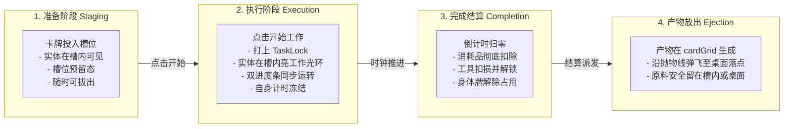

> 2026-11-09复核：本文件为设计规范，非功能完成或运行验收证明。实装状态以 ../06-整合现状与复核.md 为准；下文的验收步骤是目标行为。

# C04 - 任务全生命周期与实体状态可见性规范

> **规范等级**：
> - **E1 / E2（任务生命周期与实体可视化状态机规范）**：解决旧版把执行中的卡牌直接“吞掉隐藏”、仅展示枯燥文字任务列表的严重体验缺陷，还原真实桌面实体卡牌在场所中的全流程沉浸展示。
> - **核心准则**：所有操作必须围绕实体场所与真实卡槽发生；执行期间卡牌必须在卡槽内清晰可见且可被追踪；禁止将卡牌隐藏并单纯退化为任务列表。

---

## 一、四阶段实体生命周期状态流（Four-Stage Lifecycle）

---

## 二、实体在槽内的持续可见性与状态追踪（Persistent In-Slot Visibility）

1. **拒绝抽象任务条（No Abstract Task Rows）**：
   - 在本项目的桌面架构中，每个场所就是一个真实的操作工坊；
   - 玩家投入的“手”、“打磨石”和“帽贝岩”在工作期间**始终直观陈列在对应的卡槽中**；
   - 处于执行中时，卡牌上方覆盖一层半透明工作齿轮/发光遮罩，但玩家依然能够清晰看清是哪一只“手”（右手还是左手）正在工作、当前工具还剩多少耐久；
2. **双进度指示器同步机制**：
   - **大进度条（窗口内部）**：展示当前配方总耗时、剩余分钟、产物预览与取消按钮；
   - **小进度条（桌面实体原地）**：挂载于常驻 GameObject 的 `TimerProgressControl`，以环形或微型水平条实时展示进度百分比，即便玩家关闭了窗口，在全桌俯瞰视角下也能一目了然。
