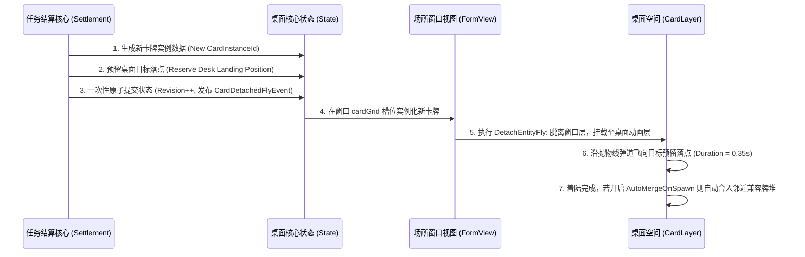

> 2026-11-09复核：本文件为设计规范，非功能完成或运行验收证明。实装状态以 ../06-整合现状与复核.md 为准；下文的验收步骤是目标行为。

# C05 - 产物飞出散开、落点预留与合堆策略规范

> **规范等级**：
> - **E1 / E2（产物生成动力学与数据拓扑规范）**：对齐 R03 逆向提取的 `DetachEntityFly` 飞牌链路与抛物线弹道物理参数，确保动效与核心数据完全一致。
> - **核心准则**：先提交身份与落点归属再播放动画；批量产物环形散开绝不重叠叠死；桌面拥挤时提供绝对不吞牌的安全退路。

---

## 一、产物生成与飞行生命周期流水线（Spawn Pipeline）

- **绝对数据安全保障**：
  - 核心状态在动画开始前已经完成提交；
  - 飞行中的卡牌即使遭遇快速退出、断电或读档，重新进入时卡牌直接稳定呈现在桌面目标落点，绝无“未落地而凭空蒸发”的致命缺陷。

---

## 二、批量产物环形扇出算法（Radial Fan-Out）

当单次采集或探索产出多张材料时，系统采用**径向偏角发射算法**：

$$\theta_i = \theta_{base} + \frac{2\pi}{N} \times i, \quad \vec{TargetPos}_i = \vec{FacilityPos} + \begin{pmatrix} R \cos\theta_i \\ R \sin\theta_i \end{pmatrix}$$

- $N$ 为产物总数，$R$ 为飞溅发射半径（默认 $160\text{px}$）；
- 每张卡牌发射时间微差 $0.05\text{s}$，产生连贯爽快的“宝箱爆装备”飞散视觉效果，且落地后各持空位，不互相压死。

---

## 三、着陆后自动合堆策略（Auto-Merge Policy）

1. **规则驱动**：
   - 若桌面规则开启 `AutoMergeOnSpawn = true`：
   - 卡牌飞落在目标点后，系统检测周围 $SnapDistance$（$65\text{px}$）内是否存在满足堆叠规则（相同定义/相同族系）且未达到 $MaxPileSize$ 的已有牌堆；
   - 若存在，卡牌平滑滑入该牌堆堆顶，自动合并整理；
2. **容量满溢安全退路**：
   - 若全桌极度拥挤无法找到完全独立的空位，产物优先降级为紧密堆叠在场所实体正下方的安全堆中，严禁吞牌、严禁丢数据！
