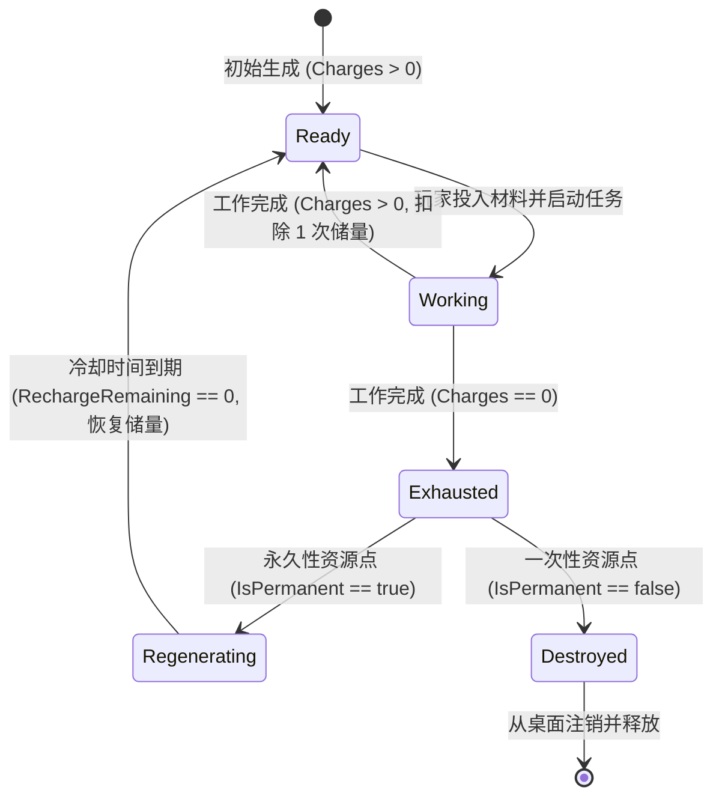

> 2026-11-09复核：本文件为设计规范，非功能完成或运行验收证明。实装状态以 ../06-整合现状与复核.md 为准；下文的验收步骤是目标行为。

# C06 - 工作进度与资源恢复分离、耗尽与销毁规范

> **规范等级**：
> - **E2 / D（资源经济与双进度通道状态机规范）**：解决工作生产进度与环境资源点自然再生周期的混淆痛点，建立明确的次数管理、冷却锁定与耗尽销毁模型。
> - **核心准则**：工作执行进度与资源恢复冷却必须在数据结构与视觉呈现上彻底分离；剩余次数归零时精准锁定卡槽；不可再生资源耗尽后自动退场。

---

## 一、双进度独立数据模型（Dual Independent Progress Model）

在场所实体状态中，严格分离两个独立的时间字段：

```csharp
public sealed class FacilityState
{
    public string InstanceId;
    public string DefinitionId;

    // 通道 1: 当前工作任务执行进度 (由工人/工具驱动)
    public int ActiveJobId;              // 当前正在执行的任务 ID (0 表示空闲)
    public int JobRemainingMinutes;      // 距离本次工作完成剩余分钟

    // 通道 2: 资源储量与自然再生周期 (由环境自然时钟驱动)
    public int CurrentCharges;           // 当前剩余可开采次数
    public int MaxCharges;               // 最大储量上限
    public int RechargeRemainingMinutes; // 距离恢复下一次储量剩余分钟
    public bool IsPermanent;             // 是否为可再生的永久性资源点
}
```

---

## 二、状态流转与双进度视觉反馈



| 场所状态 | 槽位与按钮可用性 | 原地小进度条视觉 (timer_progress) | 悬停状态文案 |
|---|---|---|---|
| **就绪可用** (`Ready`) | 允许放入卡牌，开始按钮高亮可用 | 隐藏或显示完整满格储量点 (●●●) | “储量充足 (3/3)” |
| **工作中** (`Working`) | 卡槽被加锁，允许点击取消 | 绿色顺时针旋转工作进度弧环 | “正在采集中... (剩余 2 分钟)” |
| **冷却再生中** (`Regenerating`)| 卡槽被禁用不可投入，开始按钮置灰 | 蓝色逆时针自然恢复倒计时圈 | “资源枯竭，正在自然再生 (剩余 5 分钟)” |
| **耗尽销毁** (`Destroyed`) | 不可用 | 碎裂粉碎动效 | “资源已采尽，即将瓦解” |

---

## 三、不可再生资源的销毁与废墟转化

1. **不可再生资源（如海难遗留箱、干枯灌木）**：
   - 规则中配置 `IsPermanent = false`；
   - 当 `CurrentCharges == 0` 且最后一次产物飞出完成后：
   - 核心自动触发注销该设施实例，并在原地留下轻微尘埃动画或残留一块废料（如“空木箱壳”）；
   - 彻底防止废弃设施无限制霸占有限的桌面空间。
