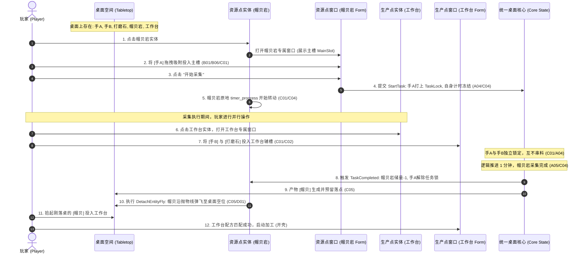

> 2026-11-09复核：本文件为设计规范，非功能完成或运行验收证明。实装状态以 ../06-整合现状与复核.md 为准；下文的验收步骤是目标行为。

# E01 - 纵向全流程整合与多任务并行交付规范

> **规范等级**：
> - **E2 / D（纵向端到端全链路集成规范）**：将底层 A/B/C/D 模块贯通为一条完整的卡牌桌面纵向操作闭环（手 + 资源点采集 -> 产物弹飞 -> 材料 + 生产点加工）。
> - **核心准则**：同一桌面多任务并行运转且绝对互斥隔离；时间流逝、暂停整理、局部引导高亮、失败回弹全流程严丝合缝；满足《操作验收矩阵》全部前置条件。

---

## 一、纵向全链路标准交互闭环（Vertical Operational Loop）

---

## 二、验收矩阵核心指标达标核对（V01 ~ V32 覆盖）

本纵向链路设计用于覆盖，尚未实装验证 `04-操作验收矩阵.md` 的核心准则：
1. **多任务并行与防串料**（V11, V13, V17）：两只手分别在两个设施中独立执行不同任务，无全局冲突；
2. **物理抛物线飞牌**（V18, V08）：产物先提交状态再沿抛物线飞向桌面，全桌拥挤时不吞牌；
3. **暂停与防抖自愈**（V22, V23, V07）：时钟暂停时不影响玩家拖动整理桌面，多重暂停掩码互不干扰；
4. **属性与守恒完整**（V06, V14）：工具耐久损耗真实扣减，未消耗的身体部位完好解锁返还。
