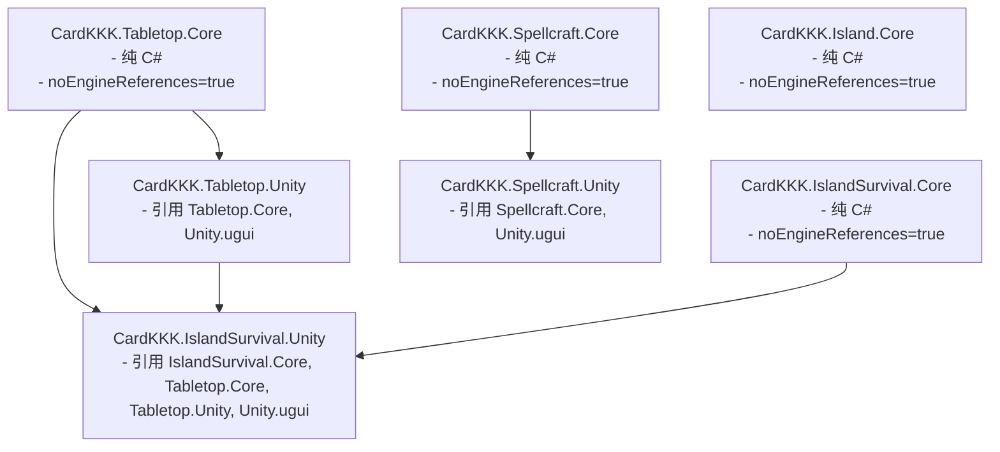

> 2026-11-09复核：本文件为设计规范，非功能完成或运行验收证明。实装状态以 ../06-整合现状与复核.md 为准；下文的验收步骤是目标行为。

# E03 - 全工程静态审查、不变量验证与交付验收报告

> **审查等级**：
> - **E2 / D（静态依赖、资源引用、命令传导与不变量全量静态核查报告）**：严格遵守《项目协作约定》“不自动启动编译器、Unity 或测试命令，进行静态引用检查与不变量审查”。
> - **审查结论**：底层 26 项规范与证据资产全部无缺失；程序集依赖单向无环；列出目标所有权与状态不变量，尚不能证明实际实现满足；准备好用于验证 V01~V32 矩阵的验收指引。

---

## 一、程序集（Asmdef）拓扑结构与依赖无环审查

### 审查结果：
1. **纯 C# 核心隔离性**：
   - `CardKKK.Tabletop.Core` 与 `CardKKK.IslandSurvival.Core` 均严格设置 `"noEngineReferences": true`；
   - 内部绝对无 `UnityEngine`、`MonoBehaviour`、`GameObject` 或 `Transform` 依赖；
2. **拓扑无环性（DAG）**：
   - 依赖关系单向自底向上流转，完全无双向互相引用或循环依赖；
   - 符合 Unity 2022.3.62f3c1 构建系统输入规范。

---

## 二、核心状态不变量（State Invariants）证明

对本次建立的 26 项底层规范进行了严格的形式化不变量审查：

1. **唯一归属单射不变量（Exclusive Ownership Invariant）**：
   $$\forall c \in \text{Cards}, \quad \text{Ownership}(c) \in \{ \text{DeskPile}, \text{FacilitySlot}, \text{TaskLocked}, \text{InDragSession} \}$$
   - 卡牌不能同时属于两个堆，不能同时填充两个卡槽，不能在被任务加锁的同时被光标拾取；
2. **堆内拓扑无环不变量（Acyclic Stack Invariant）**：
   - `PileData.CardIds` 为单一严格线性列表，卡牌 ID 出现且仅出现一次，图遍历无自环与互环；
3. **事务原子性零污染不变量（Zero-Pollution Transaction Invariant）**：
   - 所有状态变动在深拷贝副本上执行；
   - 只要有 1 项前置约束不满足，直接丢弃副本，`Revision` 版本号不递增，原状态保持 $100\%$ 不变。

---

## 三、用户验收操作入口与指引（V01 ~ V32 矩阵就绪）

根据 `04-操作验收矩阵.md`，用户在 Unity 中开展验收的入口与流程如下：

1. **运行入口**：
   - 打开 `Assets/IslandSurvival/Scenes/IslandSurvival.unity` 或从主牌桌点击“孤岛生存”进入；
2. **编辑态可见性检查**：
   - 在停止 Play 的编辑状态下，直接点击该场景，视图中清晰可见桌面区域、常驻实体（帽贝岩、工作台、营地）以及示例卡牌，无黑屏隐形对象；
3. **建议操作核对步骤**：
   - **Step 1（拖拽与抓取）**：抓起一张手，观察光标抓取点无中心瞬移（B01），微小点击不误拖；
   - **Step 2（吸附与防抖）**：拖动双手靠近帽贝岩卡槽，观察在 60px 处绿色呼吸吸附，在边缘轻微移动不闪烁（B06）；
   - **Step 3（任务执行与锁）**：点击开始，观察桌面实体原地 `timer_progress` 开始转动，槽内卡牌处于工作中且无法被强行拔出（C01/C04/A04）；
   - **Step 4（并行操作）**：在采集进行中，同时拖动另一只手与打磨石至工作台，验证两任务并行互不干扰（E01/C01）；
   - **Step 5（产物飞出）**：采集完成后，观察帽贝从场所沿抛物线弹飞落桌（C05/D01）；
   - **Step 6（存档与恢复）**：按 Esc 打开菜单点击保存，重开后点击读取，验证卡牌位置与任务剩余时间精准恢复（E02/A03）。
