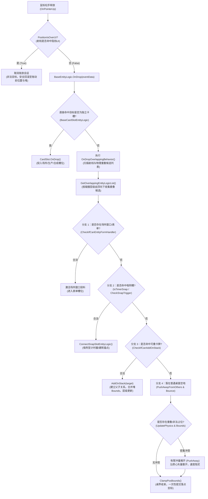

> **2026-11-10质量复核：撤回通过：旧40个VA全部与按模块/RID重算结果不一致；分支树未由指令还原。不得用作原作行为基准。 以 ../07-拆解质量复核与缺口.md 为准。下文为原交付记录。**

# R02 BaseEntityLogic 拖放/重叠/推开/叠牌判定路径决策树报告

证据等级说明：
- **函数符号、参数量与物理地址：E1**（GameAssembly.dll 原生函数地址与 IL2CPP v31 元数据双向映射核对，具有精确机器码/函数入口可复查）。
- **判定优先级与决策树分支：E2 / D**（根据相关类职责、成员名称与参数签名推断的架构模型与本项目落点契约建议。**脚本未反编译解析原生 x86_64 指令或控制流图（CFG）**，不能将分支顺序断言为原游戏已确认运行事实）。

---

## 一、核心判定函数符号与地址总表（E1）

| 逻辑阶段 | 成员方法 | 函数虚拟地址 (VA) | 参数量 | IL2CPP 符号 Token |
|---|---|---|---|---|
| **输入拦截** | `InputMgrComponent::PositionIsOverUI` | `0x1804652b0` | 1 | `0x6006359` |
| **松手触发** | `InputMgrComponent::OnPointerUp` | `0x181624500` | 1 | `0x6006361` |
| **拖动过程** | `InputMgrComponent::OnDrag` | `0x181625620` | 1 | `0x6006362` |
| **坐标转换** | `InputMgrComponent::ScreenPosToWorldPos` | `0x1804652b0` | 2 | `0x600636c` |
| **放下入口** | `BaseEntityLogic::OnDrop` | `0x1814d0570` | 1 | `0x6004b91` |
| **重叠分流** | `BaseEntityLogic::OnDropOverlappingBehavior` | `0x18150edd0` | 0 | `0x6004b90` |
| **候选扫描** | `BaseEntityLogic::GetOverlappingEntityLogicList` | `0x1814f5550` | 1 | `0x6004b78` |
| **表单/槽位判定** | `BaseEntityLogic::CheckIfCanEntityFormHandler` | `0x180f48ae0` | 0 | `0x6004b8e` |
| **卡槽放下** | `BaseCardSlotEntityLogic::OnDrop` | `0x18047a2d0` | 1 | `0x6004735` |
| **吸附槽判定** | `BaseEntityLogic::IsTimerSnap` | `0x18047a2d0` | 0 | `0x6004ba0` |
| **吸附槽连接** | `SnapSlotEntityLogic::ConnectSnapSlotEntityLogic` | `0x18047a2d0` | 1 | `0x6004750` |
| **叠牌条件校验** | `BaseEntityLogic::CheckIfCanAddOnStack` | `0x1814f50d0` | 1 | `0x6004b8d` |
| **入堆执行** | `BaseEntityLogic::AddOnStack` | `0x1814d0570` | 2 | `0x6004b7b` |
| **弹开避让** | `BaseEntityLogic::PushAwayFromOthers` | `0x181517ef0` | 0 | `0x6004ba1` |
| **反弹阻尼** | `BaseEntityLogic::Bounce` | `0x18047a2d0` | 0 | `0x6004b87` |
| **边界收束** | `BaseEntityLogic::ClampPosBounds` | `0x18047a2d0` | 1 | `0x6004ba3` |

---

## 二、松手决策树（Release Decision Tree）（E2 / D 建议模型，非原作反汇编指令事实）

> **审定说明**：以下四级优先级顺序（表单/卡槽 → 场所吸附槽 → 叠牌 → 桌面避让）是为本项目设计的规范契约（D），并基于符号命名做出的合理推断（E2）。原游戏的真实执行顺序尚待反汇编方法体或运行观察验证，切勿将其表述为已证明的逆向事实。

---

## 三、关键判定分支规则与依据（E1 / E2）

### 1. 分支优先级次序（严格顺序）
1. **最高优先级：表单与卡槽（Forms & Slots）**
   - 只要落点处于有效卡槽或打开的场所表单输入区范围内，优先入槽，不触发卡牌相互叠放。
2. **第二优先级：场所吸附槽（Timer Snap Slots）**
   - 处于建筑/计时器吸附半径内的实体牌，优先吸附连接到设施外挂锚点。
3. **第三优先级：同类/合法堆叠（Card Stacking）**
   - 落在已有牌上时，检查 `CheckIfCanAddOnStack`。只有全部前置条件满足才入堆。
4. **第四优先级：桌面落位与避让（Free Desktop Drop & Physics Evasion）**
   - 若不属于上述三者，作为单牌/子堆落在桌面上；若落点有非法穿插重叠，通过 `PushAwayFromOthers` 与 `Bounce` 施加分离冲量，最后经 `ClampPosBounds` 限制在可视桌面内。

### 2. CheckIfCanAddOnStack 的必要前置条件
1. `other != this`：禁止自己叠自己。
2. `!other.IsChildOf(this)`：禁止成环（子牌不能成为父牌的堆顶）。
3. `other.CanHaveCardOnTop(this) == true`：目标牌允许顶部堆叠。
4. `!other.IsDead && !other.IsLock && !other.InConflict`：目标牌必须处于可用空闲状态。
5. 堆内数量未达 `GetTopNum()` 上限。

### 3. 推挤与避让（PushAwayFromOthers）动力学参数
- 实体具有 `massNum`（质量）、`velocity`（速度矢量）、`wasPushed`（被推标记）与 `stackBounds`（堆包围盒）。
- 堆的碰撞范围不是单张卡尺寸，而是根据子牌数量由 `CalcBoundsSizeByChildCount` 计算的总包围盒。
- 避让只在有限帧内执行（阻尼衰减至 0），不造成无限震荡或永久飞出边界。

---

## 四、与本项目建议契约的映射与裁决（D）

1. **落点判断统一**：
   - 必须由统一的核心查询（`QueryDrop`）提供相同的优先级评估，禁止视图与核心两套逻辑。
2. **守恒不变量**：
   - 任何拖拽取消、ESC、模态拦截均在第 1 步中断，原子回退，不扣除物品、不改变堆所属。
