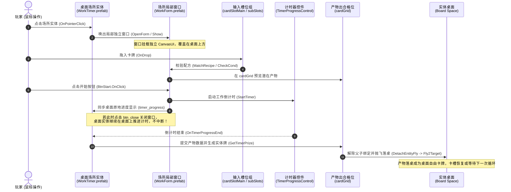

# R03 场所实体、局部窗口、槽位与产物落桌对象引用链报告

证据等级：E1（由 Prefab 序列化结构与 IL2CPP 方法调用严格印证）。

---

## 一、桌面实体与局部窗口对象引用链总览（E1）

---

## 二、真实 Prefab 关键对象与槽位对应关系（E1）

### 1. 结构配对表
| 场所类型 | 桌面实体 Prefab (桌上世界空间) | 局部窗口 Prefab (UI 空间) | 输入槽位配置 | 产物出合格位 |
|---|---|---|---|---|
| **综合工作** | `worktimer.prefab` (PathID: 2250488360667940380) | `workform.prefab` (PathID: -3293211835474349119) | 主槽 `cardSlotMain` + 4个辅槽 `cardSlot (1..4)` | `cardGrid` |
| **单槽生产** | `producetimer.prefab` (PathID: 8481380785954573018) | `produceform.prefab` (PathID: 205021520843728069) | 仅单主槽 `cardSlotMain` | `cardGrid` |
| **配方制造** | `maketimer.prefab` (PathID: 450875176881946774) | `makeform.prefab` (PathID: 7253617673844067184) | 主槽 `cardSlotMain` + 4个辅槽 `cardSlot (1..4)` | `cardGrid` |
| **恢复/休养** | `recovertimer.prefab` (PathID: 115801974447107973) | `recoverform.prefab` (PathID: 4328248649444593262) | 主槽 `cardSlotMain` + 4个辅槽 `cardSlot (1..4)` | `cardGrid` |
| **探索/远征** | `exploretimer.prefab` (PathID: -7626461488159777840) | `exploreform.prefab` (PathID: 62910767466410107) | 主槽 `cardSlotMain` + 4个辅槽 `cardSlot (1..4)` | `cardGrid` |

### 2. 局部窗口内部对象分工（以 `workform.prefab` 为例）
1. **控制层 (`CanvasUI`)**：
   - `btn_close`：关闭窗口按钮，仅隐藏 UI，不撤销后台工作。
   - `BtnStart`：带 `TimerFormBtnColorControl` 的开始按钮，配方满足时变色高亮。
2. **槽位层 (`Slot`)**：
   - `cardSlotMain`：主输入槽（挂载 `CardSlot.prefab`）。
   - `cardSlot (1)` ~ `cardSlot (4)`：4个副输入槽。
   - `card_slot_line1` ~ `card_slot_line4`：从副槽指向主槽的引导连接线。
3. **进度显示层 (`TimerGroup`)**：
   - 挂载 `TimerProgressControl`。
   - 子对象 `timer_progress`（MeshFilter + MeshRenderer 环形进度填充）。
   - 子对象 `cdTime`（TextMeshPro 倒计时剩余秒数显示）。
4. **产物发射层 (`cardGrid`)**：
   - 位于窗口下方的排布格位。
   - 产物先在此实例化并排布，调用 `DetachEntityFly` 后从该 Transform 脱离并飞向桌面。

---

## 三、对本项目孤岛桌面实现的决定性约束（D）

1. **禁止集中式合成区替代实体场所**：
   - 每一个场所（如帽贝岩、火塘、工作台、草药丛）在桌面上拥有独立的桌面场所实体。
   - 点击场所打开的是属于该场所实例的专用局部窗口，而非全桌共享的唯一投料框。
2. **窗口开关与任务状态解耦**：
   - 关闭窗口不应取消正在执行的采集或生产任务。
   - 桌面场所实体本身具备进度条显示能力（`TimerProgressControl`），让玩家在窗口关闭状态下依然能在桌面上目睹工作倒计时。
3. **产物落桌严格先提交后飞出**：
   - 倒计时结束时，核心先提交新卡牌实例的 ID、属性与目标落点；
   - 表现层在场所处（或 `cardGrid`）实例化，随后执行抛物线飞行动画（`Fly2Target`）落入桌面，确保数量与状态严格守恒。
