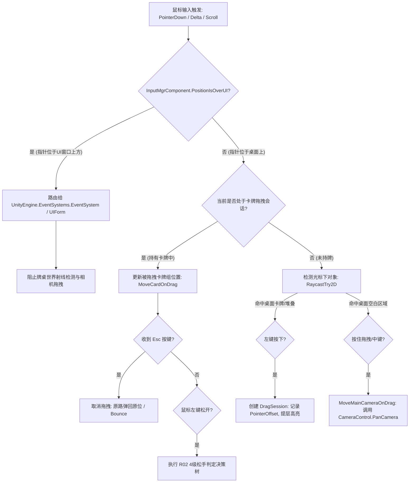

> **2026-11-10质量复核：仅输入配置层通过复核：10组Action Maps重解析一致；运行时路由等结论待追踪。 以 ../07-拆解质量复核与缺口.md 为准。下文为原交付记录。**

# R04 - 输入映射与键位表完整还原报告

> **证据等级说明**：
> - **E1（二进制与反编译绝对事实）**：`assets/gamemain/configs/inputcontrols.inputactions`（PathID: `418656196238816513`）原始输入资产反序列化数据，以及 `GameAssembly.dll` / `global-metadata.dat` 中 `InputControls`、`InputMgrComponent`、`CameraControl`、`CameraInput` 的真实方法签名与调用链。

---

## 一、输入资产（InputActionAsset）结构概览

在参考工程中，输入系统采用 Unity New Input System。资产文件反序列化出 **10 个 Action Map**，职责切分清晰：

| Action Map | 动作数量 | 主要职责 |
|---|:---:|---|
| **`gameplay`** | 8 | 牌桌主体鼠标交互（左键点击、拖拽 Delta、滚轮缩放、右键、Alt/Ctrl 修饰键） |
| **`gameUIKeyboard`** | 26 | 核心快捷键（Esc 返回、Space 暂停/继续、Tab、SnapGrid 对齐、F1~F8 调试、1~5 槽位/道具） |
| **`gameUISettingKeyboard`** | 1 | 设置弹窗快捷键（Esc） |
| **`gameBagFormKeyboard`** | 5 | 背包/行囊快捷键（数字键 1~5） |
| **`gameFormKeyboard`** | 2 | 通用界面交互键（C、F） |
| **`gameStoryFormKeyboard`** | 3 | 剧情弹窗按键（C、Z、X） |
| **`gameMapFormKeyboard`** | 1 | 大地图开关（M） |
| **`gameUITaskKeyboard`** | 1 | 任务/日程面板（Q） |
| **`gameWorld`** | 7 | 世界模式视角控制（WASD Move, Round, Look, Pointer, Space） |
| **`UI`** | 10 | 基础 UI 导航与指针标准映射（Point, Click, ScrollWheel, Navigate 等） |

---

## 二、核心 Action Map 键位明细

### 1. `gameplay`（牌桌鼠标交互）
| 动作名 | 触发类型 | 绑定路径 | 交互参数 | 运行时映射逻辑 |
|---|---|---|---|---|
| `PointerLeft` | Button/PassThrough | `<Mouse>/leftButton` | 默认 | 命中卡牌触发 `PickUp`；未命中触发牌桌背景点击/相机平移准备 |
| `DragDrop` | Value (Vector2) | `<Mouse>/delta` | 默认 | 鼠标移动增量。若持牌则更新卡牌位置；若未持牌则触发 `MoveMainCameraOnDrag` |
| `Scroll` | Axis | `<Mouse>/scroll/y` | 默认 | 滚轮 Y 轴增量，驱动 `CameraControl.ZoomCameraRelative` |
| `ScrollNegPos` | Composite 1D Axis | `-` (负) / `=` (正) | 默认 | 键盘快捷缩放替代方案 |
| `PointerPos` | Value (Vector2) | `<Mouse>/position` | 默认 | 绝对屏幕坐标，用于 `ScreenPosToWorldPos` 与 `PositionIsOverUI` 判定 |
| `PointerRight` | Button | `<Mouse>/rightButton` | 默认 | 桌面右键快捷操作 / 辅助平移 |
| `AltBtn` | Button | `<Keyboard>/alt` | Press | 修饰键：用于快捷查看提示或堆叠辅助 |
| `CtrlBtn` | Button | `<Keyboard>/ctrl` | Press | 修饰键：用于单张抽取或堆叠拆分（`IsCtrlPress`） |

### 2. `gameUIKeyboard`（牌桌全局与界面快捷键）
| 动作名 | 绑定路径 | 功能描述 |
|---|---|---|
| `Esc` | `<Keyboard>/escape` | 取消当前拖拽 / 关闭顶层弹窗 / 打开系统菜单 |
| `Space` | `<Keyboard>/space` | 全局时间流逝 暂停 / 继续（切换 TimeScale 或游戏时钟暂停） |
| `SnapGrid` | 快捷按键 | 切换网格自动吸附模式 |
| `Tab` | `<Keyboard>/tab` | 切换下一焦点 / 快速切换面板 |
| `Alpha1` ~ `Alpha5` | `<Keyboard>/1` ~ `<Keyboard>/5` | 快捷使用 1~5 号槽位/物品 |
| `GM` / `DebugInfo` | `<Keyboard>/f1` 等 | 调试信息与 GM 面板 |
| `HideAllUI` | 快捷按键 | 沉浸模式：隐藏所有 UI 面板仅保留牌桌 |

---

## 三、`InputMgrComponent` 运行时路由与拦截机制

通过反编译 `InputMgrComponent` 与 `CameraControl`，确认了其底层的关键控制逻辑：

### 关键控制逻辑提炼：
1. **UI 绝对优先拦截 (`PositionIsOverUI`)**：
   - 每次光标事件前先通过 `EventSystem.IsPointerOverGameObject()` / UI 判定检测。
   - 若光标在场所窗口、状态栏或弹窗上，牌桌射线检测被完全切断，避免“隔窗抓牌”。
2. **相机平移与卡牌拖拽互斥**：
   - 拖拽会话开始时锁定相机输入；
   - 仅当拖拽会话为空且光标作用于桌面空白背景时，拖拽增量（`<Mouse>/delta`）才会送往 `CameraControl.PanCamera`。
3. **坐标投影与边界保护**：
   - `ScreenPosToWorldPos`：将屏幕像素坐标准确映射到 2D 桌面世界坐标（考虑相机 Orthographic 尺寸）。
   - `lookBounds`：桌面视口具有明确的矩形边界，防止玩家将相机移出桌面无限空白处。
4. **平滑缩放与衰减 (`ZoomDecay`)**：
   - 滚轮驱动 `ZoomCameraRelative` 调整正交相机 `orthographicSize` 或 Z 轴距离，并通过 `ZoomDecay` 逐帧做插值衰减，避免画面顿挫。

---

## 四、对本项目卡牌底层的移植契约

结合本项目目前技术栈（Unity 2022.3.62f3c1、Windows 鼠标单机牌桌），本报告为后续交互实现（B01、B03、B07、B08）确定以下输入契约：

1. **拖拽会话模型（DragSession）**：
   - 记录 `PointerOffset = CardWorldPos - MouseWorldPos`，确保抓起牌时不会出现“瞬间瞬移到卡牌中心”的跳变。
   - 保持主牌与子牌相对偏移不变。
2. **分层射线命中排序**：
   - 优先检查 UI 阻挡；
   - 桌面碰撞体优先拾取 Topmost（`SortingOrder` 最大者）。
3. **Esc 取消安全保护**：
   - 拖拽过程中按下 Esc 或窗口失去焦点，必须安全调用 `AbortDrag`，触发位置回弹，严禁卡牌悬浮孤立在半空中。
