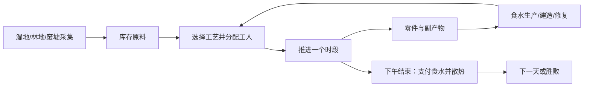

# 《余烬工坊》可执行策划案 v0.1

日期：2026-11-03。定位：两人团队、Unity、Windows 单机、以卡牌和中文界面表现的生存生产游戏。

**本案建议先做一个 14 天、约 30～45 分钟的单场景原型：维持两人的饮水和口粮，选择不同工艺回收废料，在期限内修好中继塔。** 三条回收工艺都产零件，但工时、耗水、热负荷和副产物不同。玩家要根据当前瓶颈换工艺。

本次交付是策划、配置数据草案和开发任务，未实现生产玩法。当前仓库已有的是卡牌桌面底座；现有配置窗口尚不能运行下文配方，也没有下文 CSV 的导入器。

## 1. 已知要求与本案做出的选择

| 类型 | 内容 |
|---|---|
| 用户已明确 | 两人开发、Unity、单机、没有专职美术、用 AI 资源、保留必要动画、代码便于配置和修改 |
| 截图提供的方向 | 配方投入与产出、升级工艺、获得新材料；发展不必是一条线；同级工艺的主产出相近而副产物不同 |
| 本案建议，尚待原型验证 | 荒废中继站题材；两名抽象工人；每日两个时段；只有食水与热负荷三类压力；14 天修复目标 |
| 本案的重点假设 | 副产物能够让玩家因需求和环境改变工艺，而不是一直点同一条高等级配方 |

题材与数字可修改。不要把本案中的数值视为已经验证的平衡，也不要把建议记录为用户已经批准的最终玩法。

## 2. 参考作品：取机制，控制模拟范围

| 参考 | 官方介绍能确认的机制 | 本案取用 | 首版边界 |
|---|---|---|---|
| 《卡牌生存：热带岛屿》 | 通过使用和组合卡牌探索、采集、制造，管理生存需求 | 卡牌代表原料与设施，时间支出迫使玩家安排生产 | 不做疾病、心理、身体部位、动物生态和多环境地图 |
| 《缺氧》 | 持续资源消耗、热管理、能源转换和废物再利用 | 一条产线的副产物成为另一条产线的投入，生产受热负荷约束 | 热负荷是一个抽象数值，不做传热、气液流动、管线、电网和居民寻路 |
| 《Stacklands》 | 叠牌收集资源和建造，周期末供养村民，Idea 卡公开配方 | 周期结算、明确配方、物品堆叠、可读短目标 | 不做卡包经济、战斗和无限扩张 |
| 《WitchHand》 | 分配工人、生产和研究，并提供不同经营方向 | 有限工人分配到不同工艺，建设设施打开横向选择 | 不做阵营、外交、法术、角色职业与战争 |

来源：[Card Survival 官方商店](https://store.steampowered.com/app/1694420/Card_Survival_Tropical_Island/)、[缺氧官方介绍](https://www.klei.com/games/oxygen-not-included)、[缺氧官方商店](https://store.steampowered.com/app/457140/Oxygen_Not_Included/)、[Stacklands 官方商店](https://store.steampowered.com/app/1948280/Stacklands/)、[WitchHand 官方商店](https://store.steampowered.com/app/2420880/WitchHand/)。

“同主产出、异副产物”是本项目从这些机制推导出的原创规则，不是声称上述作品有相同配方。所有配方数字均为本案的原型假设。

## 3. 玩家体验与完整循环

玩家接管一座断联的回收工坊。食水储备只能维持数天，废料里却有修复中继塔需要的材料。玩家每天安排工人采集、制作或散热，用今天的资源换取未来的产能和通关进度。

期望出现的决策是：“现在缺的是时间、净水、燃料，还是某种副产物？”玩家应当能在界面中看到这些代价，而不是通过失败猜规则。

单次操作流程：点击设施 → 选择配方 → 看投入、工时、热负荷、主产物和副产物 → 选择空闲工人 → 点击“开始” → 点击“推进时段”。拖动物品只用于整理和打开对应工艺面板，不会因误叠自动消耗材料。

## 4. 首版硬边界

| 项目 | 首版固定范围 |
|---|---|
| 场景 | 一个固定工作站，三个采集地点，不切地图 |
| 时钟 | 每天上午、下午两段；只有点击“推进时段”才流逝 |
| 劳动力 | 两个同能力工人；每段每人只能参加一个作业，合计每天四个工人段 |
| 资源 | 14 种物品；每张物品牌为一个单位，不做重量、品质、保质期和耐久 |
| 设施 | 四个初始设施、两个可建造设施；每种设施至多一个，每设施一次一个作业 |
| 配方 | 18 条，包括采集、制造、建造、通风和重复三次的修复作业 |
| 压力 | 净水、口粮库存，以及 0～10 的热负荷 |
| 目标 | 第 14 天夜间结算结束前完成中继塔三次修复，并足额支付最终夜食水 |
| 原型内容 | 单一固定剧本，没有随机事件、随机资源掉落、研究点或多难度 |

设施、地点、工人放在固定面板中，仍以卡牌样式表现；物品放在可拖动桌面中。摆放距离与朝向不影响效率。这样可以复用现有物品牌堆交互，同时避免寻路、运输与设施碰撞规则。

先不做自动循环生产、自动搬运、配方盲猜、通用脚本解释器、复杂科技树、多个角色技能、战斗、联网、开放世界。新增范围须有试玩证据支持。

## 5. 时间、结算与胜败的精确定义

### 5.1 工人和作业

- 表中的“1 段”表示一个工人占用一个时段；“2 段”表示同一工人连续占用两个时段，不是两人同时做一段。
- 初版不允许第二个工人加速同一作业。两段作业可跨夜，夜间不额外推进，次日上午继续占用该工人。
- 同一设施一次只能处理一批。采集地点也视为单作业设施，同段不能派两人重复采同一地点。
- 配方完全已知。设施建成就开放其工艺，不额外增加研究货币。热炉与洗选槽是并列建设选择，没有相互前置。
- 点击“开始”时一次检查材料、空闲工人、设施和热预算；全部通过后，消耗投入、占用工人并创建作业。开始前可任意改选；开始后首版不提供取消和退款。
- 当段结束，所有运行作业的剩余时段减一，完成的作业把产物放入各自缓冲并释放工人。**不能用同一时段刚完成的产物提前启动另一项作业**，它们只能在下一次规划中使用。
- 同一天可以先后使用同一设施。例如上午烧水、下午烹饪。
- 可以让工人空闲后推进时段；空闲工人不产出物品，也不暂停日期。规划阶段不消耗时间。

### 5.2 热负荷

热负荷 H 为抽象压力，不是摄氏温度。初值 0，范围 0～10。配方的热变化在“开始”事务中结算，表示立即占用或释放散热能力；正变化若使 H 超过 10，则整项开始操作拒绝，材料和工人不变。负变化最低降到 0。

“通风”占一个工人段，开始时 H 降 4，无材料投入。H 满时仍能手拆、采集、湿分拣和通风。首版没有热伤害、设施随机损坏或永久停机；限制来自热预算和通风占用的工时。每晚自然散热 2。

热预算会受本轮开始操作的先后影响，界面每次开始后立即更新预览；可以先安排通风，再启动热作业。通风工人仍须等到时段结束才能执行其他任务，不能用反复取消刷散热。

### 5.3 每夜结算顺序

1. 下午作业推进并生成缓冲产物；可装下的整批产物自动领取。
2. 若仍有因容量而滞留的食水，打开“夜间结算前整理”状态，允许领取或丢弃以腾位；不推进时间、不启动新作业。
3. 汇总库存，显示“今夜净水 2、口粮 2”的实际支付结果；缓冲中未领取的物品不能用于供给。
4. 任一库存不足 2，当夜结算失败，给出缺口与最近生产记录。不能靠略过供给继续生产。
5. 两项都足额则各扣 2，自然散热 2，检查三阶段修复是否完成；完成则胜利。
6. 未胜利且当天为第 14 天，则期限失败；否则进入次日上午。

库存支付后为 0 是合法状态。失败根据“支付前是否足额”判断，不以支付后库存为 0 判断。第一版使用严格供给失败，第一夜前始终有四天起始食水储备；若试玩显示学习惩罚过重，再试一次性救济或放宽期限，不先叠加健康系统。

未满容量时夜间结算可自动进入；存在滞留或缺口时停在预览，由玩家点击“结算夜晚”。关闭程序与读档不能跳过供给。

## 6. 起始配置、资源来源与通关目标

起始物品：净水 8、口粮 8、木料 6、废料 6、纤维 2、木炭 2；其他物品为 0。热负荷 0，工人 2，中继塔阶段 0。

初始设施：营地工位、灶台、工作台、中继塔。三个地点：湿地、林地、废墟。热分离炉和洗选槽需建造，首版不可拆除或重复建造；固定面板不占物品容量。

| 地点 | 投入 | 工时 | 每批得到 | 限制 |
|---|---|---|---|---|
| 湿地 | 无 | 1 段 | 污水 4、食材 2 | 同时只一个采集作业 |
| 林地 | 无 | 1 段 | 木料 4、纤维 1 | 同上 |
| 废墟 | 无 | 1 段 | 废料 4 | 同上 |

来源不枯竭、没有随机损失，但采集始终消耗工人段。因此可以挽回材料选择上的错误，不能靠不推进时钟无限采集。

中继塔需要三次相同修复，每次消耗零件 4、加固板 1、导线 1，占一个工人段。修复完成才使阶段加一；单纯提交材料不算完成。总目标为零件 12、板 3、线 3，加三段修复工时。第 1、2 次完成提供故事和进度反馈，不偷偷提高生存消耗或赠送未配置材料。

## 7. 核心工艺：同主产出，副产物决定后续用途

| 工艺 | 投入 | 主产出 | 副产物 | 工时 | 热变化 | 适合的局面 |
|---|---|---|---|---|---|---|
| 手工拆解 | 废料 2 | 零件 2 | 导线 1 | 2 段 | 0 | 水、炭或散热预算紧张；需要导线；尚未建设机器 |
| 热分离 | 废料 2、木炭 1 | 零件 2 | 炉渣 1 | 1 段 | +3 | 抢工时、燃料足、希望用炉渣快速制板 |
| 湿分拣 | 废料 2、净水 2 | 零件 2 | 浆料 1 | 1 段 | 0 | 热预算紧而净水充足；准备把浆料接入滤芯净水 |

这是三种平行工艺，不用 I/II/III 排成全面替代的等级。工艺进步体现在拥有更多处理条件与组合能力，而不是给所有配方统一加产量。

副产物的具体去向：

- **导线**：直接参与中继修复。缺导线时也可用零件 1 制成导线 2，确保不强制玩家一直手拆。首版不做导线转回零件的无聊双向循环。
- **炉渣**：木料 2 + 炉渣 1，用一段制板；保底木料 3 + 纤维 1，需要两段制板。热路线节省了一段工时和部分木耗，但增加了上游燃料与散热开销。
- **浆料**：浆料 1 + 木炭 1 制滤芯 1；滤芯 1 + 污水 4 得净水 4。把这段与湿分拣合并，净式为“废料 2 + 木炭 1 + 外部污水 4 → 零件 2 + 净水 2”，合计三个工人段，仍需净水 2 作启动资金。水来自采集，不会循环凭空产水。

副产物不附带一套污染系统。用不到时可以丢弃，代价是失去资源收益和已经支付的工时；丢弃不能撤销热负荷。导线、炉渣的主要需求在本关有限，后期价值降低是允许的，首版不为“每种废物必须永远有用”再增加十条配方。

这组规则仍可能在试玩中出现单一最优解。若某条工艺在缺水、过热、缺燃料、赶期限等不同局面下都被选择，应先调成本或缩减路线，不能用更多材料种类遮盖问题。

## 8. 完整首版配方表

所有配方占一个工人，热变化均在开始时结算。空产出表示状态效果，不生成库存卡。

| ID | 配方 / 工位 | 投入 | 产出或效果 | 时段 | 热 |
|---|---|---|---|---|---|
| R01 | 湿地采集 / 湿地 | 无 | 污水 4、食材 2 | 1 | 0 |
| R02 | 林地采集 / 林地 | 无 | 木料 4、纤维 1 | 1 | 0 |
| R03 | 废墟搜集 / 废墟 | 无 | 废料 4 | 1 | 0 |
| R04 | 煮水 / 灶台 | 污水 2、木料 1 | 净水 2 | 1 | +1 |
| R05 | 烹饪 / 灶台 | 食材 2、木料 1 | 口粮 4 | 1 | +1 |
| R06 | 烧炭 / 灶台 | 木料 2 | 木炭 3 | 1 | +2 |
| R07 | 手工拆解 / 工作台 | 废料 2 | 零件 2、导线 1 | 2 | 0 |
| R08 | 热分离 / 热分离炉 | 废料 2、木炭 1 | 零件 2、炉渣 1 | 1 | +3 |
| R09 | 湿分拣 / 洗选槽 | 废料 2、净水 2 | 零件 2、浆料 1 | 1 | 0 |
| R10 | 制导线 / 工作台 | 零件 1 | 导线 2 | 1 | 0 |
| R11 | 手工制板 / 工作台 | 木料 3、纤维 1 | 加固板 1 | 2 | 0 |
| R12 | 炉渣制板 / 工作台 | 木料 2、炉渣 1 | 加固板 1 | 1 | 0 |
| R13 | 制滤芯 / 工作台 | 浆料 1、木炭 1 | 滤芯 1 | 1 | 0 |
| R14 | 滤芯净水 / 洗选槽 | 滤芯 1、污水 4 | 净水 4 | 1 | 0 |
| R15 | 通风 / 营地工位 | 无 | 热负荷降低 4，最低 0 | 1 | -4 |
| R16 | 建热炉 / 营地工位 | 废料 2、木料 2 | 完成时建设热分离炉 | 1 | 0 |
| R17 | 建洗选槽 / 营地工位 | 废料 2、纤维 2 | 完成时建设洗选槽 | 1 | 0 |
| R18 | 修复中继 / 中继塔 | 零件 4、加固板 1、导线 1 | 完成时阶段 +1，最多 3 | 1 | 0 |

配置表见 `docs/planning/ember-workshop/配方表.csv`、`卡牌表.csv`、`剧本.json`。表中技术 ID 与中文名分开，规则采用明确配方和少量效果类型，不做任意脚本字段。

## 9. 库存、缓冲与异常操作

- 一张物品牌为一个单位，数量由牌堆成员数推导，不另存一份可变 Quantity。物品按相同定义叠放。
- 库存最多 80 单位、20 个物品堆，每堆最多 20 单位。物品进入库存桌面；设施、工人、地点为独立状态和固定视图，不计入这个容量。
- 牌堆统一错开 3 单位并显示计数，视觉与核心几何同时修改，不能只压紧图片而保持旧碰撞高度。
- 每个作业完成后产生一个批次缓冲，包含全部主产物、副产物；当前配方最大一批 6 单位，缓冲上限 8 单位。缓冲不创建库存卡，不可与库存重复计数。
- 时段结束按稳定工位顺序尝试自动领取整批。若 80 单位、20 堆或真实桌面空位不足，则整批保留在该缓冲，该设施不能开下一批；不会删除产物或继续扣材料。
- 玩家可丢弃指定库存单位、整理桌面后重试领取，也可明确丢弃整批缓冲。首版不做部分领取、部分退款、跨设施自动搬运。
- 完成作业即释放工人，缓冲未领取只堵设施，不堵工人。每批有唯一 ID，领取与清空缓冲在同一个事务提交。
- 固定位置之间没有运输时间。摆得近不会增产，整理不改变资源数量或作业状态。

满仓、保存中作业、同一单位被两个设施同时选中、建造重复设施、连续点击“开始”、夜间缺粮、读取旧档，均须有明确拒绝或恢复语义。

## 10. 第一局引导与界面

固定界面分区：顶部显示日期/时段、净水与口粮可支付几夜、热负荷和中继进度；左侧三个地点；中间物品桌面；右侧设施及配方详情；底部两个工人和“推进时段”。

选择一条配方时同时显示五项：投入、主产出、副产物、工人段、热变化。切换手拆/热/湿工艺时使用同一张对比表，缺料项标出缺口，不能仅把按钮变灰。

建议首局前四天的可跳过提示：

1. 第一天，安排手拆和建设热炉，体会两段作业会占住工作台；另一工人仍可采集。
2. 第二天，做一批热分离，展示同样的零件更快产出，但多了热负荷和炉渣。
3. 第三天，用炉渣做板，完成一次“副产物有实际去向”的回收闭环。
4. 第四天，提交第一次中继修复，提示现在可以继续手拆、建洗选槽或采用热路线；不锁定后续答案。

必要动效仅做拿起/放下、插槽反馈、消耗收拢、产物进入缓冲、进度填充、热变化和目标完成。复用已有约 0.18 秒的卡牌过渡作为初始值；动画时长后续按实际操作调整。无角色行走、骨骼、战斗特效或逐帧动画。

## 11. 一条可通关的账本

这是一条展示三种工艺的构造性路线，不是最优解或已验证的新手教程。每格两项由两个工人同时执行；手拆①/②是同一作业的两段。

| 天 | 上午 | 下午 | 夜间供给支付后的净水 / 口粮 / 热 | 已修复阶段 |
|---|---|---|---|---|
| 1 | 手拆①；建热炉 | 手拆②；林地 | 6 / 6 / 0 | 0 |
| 2 | 废墟；烧炭 | 热分离；湿地 | 4 / 4 / 3 | 0 |
| 3 | 煮水；热分离 | 烹饪；炉渣板 | 4 / 6 / 6 | 0 |
| 4 | 修复①；湿地 | 林地；通风 | 2 / 4 / 0 | 1 |
| 5 | 废墟；建洗槽 | 湿分拣；煮水 | 0 / 2 / 0 | 1 |
| 6 | 制滤芯；烹饪 | 滤芯净水；林地 | 2 / 4 / 0 | 1 |
| 7 | 湿地；废墟 | 湿分拣；煮水 | 0 / 2 / 0 | 1 |
| 8 | 制滤芯；湿地 | 滤芯净水；烹饪 | 2 / 4 / 0 | 1 |
| 9 | 制导线；热分离 | 炉渣板；湿地 | 0 / 2 / 1 | 1 |
| 10 | 煮水；林地 | 烹饪；修复② | 0 / 4 / 1 | 2 |
| 11 | 手拆①；煮水 | 手拆②；林地 | 0 / 2 / 0 | 2 |
| 12 | 煮水；炉渣板 | 烹饪；湿地 | 0 / 4 / 0 | 2 |
| 13 | 煮水；废墟 | 湿分拣；煮水 | 0 / 2 / 0 | 2 |
| 14 | 烹饪；湿地 | 煮水；修复③ | 0 / 4 / 0 | 3，胜利 |

第 14 夜支付前净水恰有 2，支付后为 0，仍然胜利。路线用满 56 个工人段，包含额外囤积和展示动作，不能据此宣称所有新手都有充足容错。最高热负荷 8。研发阶段先把这条路线做成可复核的固定验收场景，再观察自由试玩是否过紧。

已按配方表逐时段做静态算账，核对材料扣除、工人和工位占用、两段作业、热预算、夜间供给及账本每列，结果与上表一致；本路线峰值库存 41 单位。记录见 `docs/planning/ember-workshop/static-balance-check.json`。这说明至少有一条数值可达路线，不代表 Unity 中已经实现，也不证明自由试玩的平衡或操作体验。

## 12. 配置结构与现有代码接法

### 12.1 已有可复用能力

`BoardEngine` 的唯一归属校验、候选快照、拖放规划、空间查询、失败回滚，现有中文窗口、牌面 Prefab、动画、输入和文件原子替换机制都可以复用。保留自由桌面演示作为交互样例；正式玩法使用独立场景和独立规则配置，避免覆盖用户现有配置及美术引用。

### 12.2 必须新增的玩法层

| 模块 | 最小职责 |
|---|---|
| `GameEngine / GameSnapshot` | 整局唯一写入口；库存桌面、设施、工人、作业、日期/时段、热、修复阶段和结算状态 |
| `RecipeDefinition` | ID、中文名、工位、投入、主/副产物、持续时段、热变化、完成效果 |
| `FacilityDefinition` | ID、名称、插画、可执行配方、单作业和缓冲容量、是否初始存在/可建造 |
| `ScenarioDefinition` | 起始资源、初始设施/地点、工人数、每日时段、消费、热上限/自然散热、期限与目标 |
| `ProductionPlanner` | 配方预览、按稳定顺序选物品 ID、缺料与热预算判断、批量扣除/输出计划 |
| `TurnResolver` | 统一推进时段、完成作业、自动领取、晚间整理与供给、胜败 |
| `ProductionView / Handbook` | 设施状态、横向配方对比、工人占用、缓冲、下一次结算预览 |
| `GameSaveStore v2` | 保存整局，不仅保存桌面；完整验证后原子替换 |

现有 `BoardSnapshot` 只有卡和牌堆，现有引擎没有批量消耗或作业 API。不能在 Controller 中“先删材料、连续 Spawn 输出、最后改机器”，否则可能只提交一半。

实现应把桌面规划/校验抽成接受候选 `BoardSnapshot` 的子系统。所有库存拖拽和制作命令都由 `GameEngine` 在候选 `GameSnapshot` 上一次验证、一次发布。原桌面演示可保留适配外壳，不让两个引擎各自提交后再补偿。不要为这一步改成 ECS、通用事件总线或反射效果图。

完成效果首版只需要 `None`、`BuildFacility`、`AdvanceBeacon` 三种；热变化单独是受限整数。需要可复用的明确类型，不加入任意 C# 字符串执行或表达式语言。

### 12.3 配置入口的新增页面

继续扩展中文规则窗口，新增“配方”“设施”“剧本”页。配方和设施资产由设计者修改，运行状态不写回资产；窗口显示实际剧本引用的配置，并支持定位配方。CSV/JSON 先作为审核过的内容草表，导入器列为开发任务，导入不能覆盖手动引用的插画。

启动校验至少拒绝：未知资源 ID、非正投入/产出、空效果且无产出又无热变化、时段不为 1/2、未知工位、单批产物超过缓冲、重复设施、初始库存超限、供给无可达来源、目标资源没有可达配方。首版还要静态审核资源循环，拒绝没有外部投入和时间代价的关键资源净增；不要求编写任意配方图的完整经济证明器。

### 12.4 存档边界

v2 保存库存单位 ID/归属、运行作业及剩余时段、已消耗投入的作业记录、缓冲批次、工人分配、设施存在状态、日期/时段/热、目标阶段、是否处于夜间整理/结算。首版无随机数，无需保存一个实际不使用的随机状态。

保存仅发生在完整命令边界；读取失败保留当前整局。v1 自由桌面存档不自动当作生产游戏存档，正式玩法另用 `ember-workshop-v2.json`。已有 v1 桌面读档入口继续归原演示。

正式玩法保留选择、拖动、拆合堆、桌面整理和存读。翻面、洗牌、堆内排序/调序和抽顶牌快捷操作没有玩法职责，可用现有独立模块裁剪；Shift 拆一单位仍是库存基础交互。正式场景移除自由发牌入口，不靠隐藏后仍可响应的快捷键提供资源。

## 13. 两人开发排期与退出条件

假设两人熟悉 C#/Unity、接近全职，每人每周约 25～30 小时有效开发。**八周是原型预算，不是可售成品承诺。** 兼职按实际工时延长；现有重构未由本轮编译验证，第一周必须先由用户导入确认并留修复余量。

| 周 | 工程 A 主线 | 工程 B / 内容主线 | 当周可见出口 |
|---|---|---|---|
| 1 | 唯一整局事务、库存候选适配、批量消费/创建 | 冻结 18 条配方，固定面板白盒、数据资产 | 一次开始/领取要么全部成功，要么全部不变 |
| 2 | 工人、设施单作业、两段作业与缓冲 | 工艺详情、缺料预览、6 条基础采集/生存配方 | 一条采集—煮水—供给链能连续运行 |
| 3 | 日期、热、夜间整理/供给、胜败 | 手拆/热分离、炉渣制板、四天引导 | 4 天切片能完成首次修复并解释热代价 |
| 4 | v2 存档、建造、所有配方配置连接 | 湿路线和滤芯回收、14 天账本 | 能保存两段作业中途、读取后不重复出货；14 天可完整通关 |
| 5 | 配置窗口、导入器、数据校验、正式模式关闭自由发牌 | 全部说明、横向对比、调整桌面容量 | 设计者修改配方数字后下次启动真实生效 |
| 6 | 操作反馈与日志，修复阻塞和双点边界 | 邀请首轮试玩，统一少量 AI 资源与中文文案 | 新玩家能独立做首批生产，并说明副产物用途 |
| 7 | 按证据修存档/事务/配置问题 | 调数值、删无用配方、调整期限 | 消除已知复制/吞料/无来源资源；复查单一最优路线 |
| 8 | 修复和打包，留必要运行检查时间 | 第二轮试玩、声音和必要动效 | 交付固定剧本原型与下一阶段清单 |

详细任务见 `docs/planning/ember-workshop/开发任务.csv`。工程验收由团队在实际 Unity 环境执行，本次不运行编译或游戏检查。

若第二周尚不能可靠完成一批生产，暂停新增资源和美术，先修事务。若第四周的两条工艺仍无法让玩家解释选择，保留两条并缩短剧本，先不做第三条内容。

## 14. 最小可玩切片与验收

先做 4 天切片：截止第 4 夜、目标修复一次；起始配置和生存结算不变。只有湿地/林地/废墟、营地工位/灶台/工作台/热炉/中继塔、手拆/热分离；R09/R13/R14/R17 及洗选槽/浆料/滤芯定义整组不装载，避免留下半工作入口。完整原型才扩到 14 天、三次修复与第三条工艺。

| 验收项 | 可观察结果 |
|---|---|
| 首次生产 | 新玩家无需阅读聊天记录，能选配方、派工并得到一批产物 |
| 原子性 | 缺料、工位忙、热预算不够时，库存/工人/热/作业均不变 |
| 时钟 | 拖动、看说明、保存不推进时段；手拆确实占同一工人两段 |
| 回收选择 | 同量零件的三条工艺能解释时间、耗材、热与副产物差别 |
| 满仓 | 完成批次保留在缓冲；释放工人；腾位后只领取一次 |
| 夜间 | 当晚供给足额支付后为 0 可以继续；不足时报告准确缺口 |
| 保存 | 跨夜作业、完成未领批次、夜间整理状态能完整恢复，不能复制产物 |
| 通关 | 附录路线可到第 14 夜并胜利；三次修复均实际完成 |
| 配置 | 改一条产出/工时/热成本，预览与实际结算一致；无效配置给中文错误 |

可重复的规则检查不等于玩法好玩。玩法验证聚焦一个问题：**玩家是否因为当前瓶颈和副产物需求，主动改变回收工艺？**

首轮建议邀请 4～6 位目标玩家做定性发现，不据此声称统计有效。记录他们的路线、选择时的库存/热/剩余时段、缓冲堵塞次数和口述理由。若反复只选一种工艺，先区分成本支配、信息未读懂和无实际副产物需求。若只是在不停煮水，应提高维生产出的批量或起始储备；若长期无决策，应先调整瓶颈与目标，再考虑事件。

可以对比“只显示主产出”和“同时显示副产物及去向”的两种提示，其他成本和剧本保持一致，用于判断问题是否来自信息呈现。没有试玩前，不能承诺这组配方已经有深度。

## 15. 美术预算与后续扩展顺序

24 种卡牌定义不等于 24 张独立大插画。白盒阶段物品用中文名、颜色和简图形，设施与地点用统一占位。后续优先做 1 张桌面背景、5～6 张设施小图、3 张地点图、1 张工人图和 1 张卡背，约 11～12 张图片；资源图标可继续用文字与色块。统一边框、光照和比例，文字始终由 Unity 排版。

音频先用拾起、放置、开工、完成、拒绝、警报六种短反馈与一条环境循环，不需要配音。首版不生成骨骼角色、行走动画或大量建筑等级外观。

原型达标后按顺序考虑：提高配方对比和批量操作便利性 → 少量固定事件与不同起始条件 → 一条新的副产物用途或工艺 → 更长目标。先验证短局重玩价值，再考虑研究分支、自动化和随机地图。

本案尚需由试玩回答的重点：14 天是否过紧、湿路线的启动水成本是否值得、三阶段目标会不会过于重复、物品拖拽是否成为整理负担。这些属于设计假设，已有独立配置入口和删减边界可供调整。
